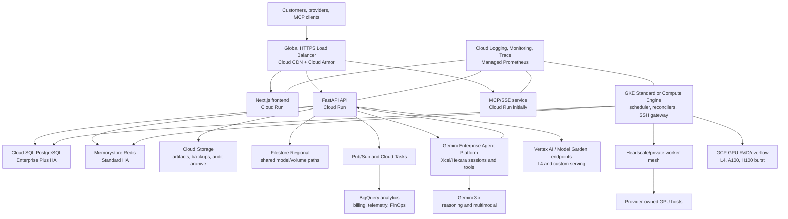

<!-- residency-guard: documents-removal — submitted proposal, a record of what was pitched -->
# Xcelsior Google Cloud AI Infrastructure and Funding Proposal

**Prepared:** July 28, 2026

**Company:** Xcelsior Compute Inc.

**GCP organization administrator:** `aaryn.biro@xcelsior.ca`

**Existing GCP project inspected:** `xcelsior-gpu`

**Proposal horizon:** Year 1 plus Year 2 growth extension

**Currency:** USD with CAD planning equivalents

**Planning exchange rate:** USD 1.00 = CAD 1.4114, the Bank of Canada daily average for July 27, 2026

> This is a cloud and AI infrastructure forecast, not a binding Google quote or a complete corporate P&L. Prices, quotas, taxes, discounts, credit eligibility, and product availability must be confirmed with Google before commitments are signed. The model deliberately budgets production-safe capacity and a large-organization AI development workload; it is not a minimum-cost architecture.

## 1. Executive decision

Xcelsior has a credible technical basis for an AI-first Google for Startups application. The codebase is not a landing page wrapped around an API: it is a substantial GPU marketplace and control plane with agent tooling, serverless inference, billing, provider payouts, scheduling, storage, telemetry, reputation, privacy, compliance, and multi-provider cloud-burst logic. Gemini, Gemini Enterprise Agent Platform, Model Garden, Vertex AI evaluation/tuning, and GPU infrastructure can become foundational components of the product rather than incidental developer tools.

The recommended application request is the full **USD 350,000 AI-startup credit envelope**, subject to program eligibility. The proposed eligible Google Cloud consumption plan is:

| Period | Eligible GCP spend, USD | Eligible GCP spend, CAD | Program credit modeled | Credit, CAD | Uncovered eligible spend |
|---|---:|---:|---:|---:|---:|
| Year 1 | $250,000 | C$352,850 | 100%, capped at $250,000 | C$352,850 | $0 |
| Year 2 | $500,000 | C$705,700 | 20%, capped at $100,000 | C$141,140 | $400,000 |
| **Two years** | **$750,000** | **C$1,058,550** | **$350,000 maximum** | **C$493,990** | **$400,000** |

The Year 2 result is the critical financial point: the current program advertises 20% coverage up to an additional USD 100,000. Realizing the full Year 2 credit therefore requires approximately **USD 500,000 of eligible Year 2 consumption**. It does not mean that a USD 100,000 Year 2 bill is fully covered.

Including estimated Enhanced Support, Google developer subscriptions, and non-GCP technology vendors, the broader technology forecast is:

| Period | Eligible GCP services | Support and Google subscriptions | Non-GCP technology | Gross technology spend | Modeled startup credit | Net after startup credit |
|---|---:|---:|---:|---:|---:|---:|
| Year 1 USD | $250,000 | $24,400 | $40,000 | **$314,400** | ($250,000) | **$64,400** |
| Year 1 CAD | C$352,850 | C$34,438 | C$56,456 | **C$443,744** | (C$352,850) | **C$90,894** |
| Year 2 USD | $500,000 | $41,900 | $82,000 | **$623,900** | ($100,000) | **$523,900** |
| Year 2 CAD | C$705,700 | C$59,138 | C$115,735 | **C$880,572** | (C$141,140) | **C$739,432** |
| **Two-year USD** | **$750,000** | **$66,300** | **$122,000** | **$938,300** | **($350,000)** | **$588,300** |
| **Two-year CAD** | **C$1,058,550** | **C$93,576** | **C$172,191** | **C$1,324,317** | **(C$493,990)** | **C$830,327** |

This high-capacity plan must be operated behind spend gates. Xcelsior currently has one confirmed successful CAD 10 payment in the production database and no publicly rentable GPU capacity. Credits can responsibly fund the Year 1 migration and R&D plan; Year 2 production expansion should not be activated merely to consume credits.

## 2. Investigation scope and evidence

The assessment used four evidence sources:

1. The local repository at `/home/aaryn/storage/projects/xcelsior`, including application code, migrations, dependencies, Docker Compose, Nginx, deployment tooling, architectural documents, and implementation checklists.
2. The live website and public APIs at `https://xcelsior.ca`, inspected with Chrome DevTools on July 28, 2026.
3. Read-only inspection of the running production host and PostgreSQL database.
4. Read-only authenticated inventory of GCP project `xcelsior-gpu`, plus current official Google pricing and program documentation.

No GCP service was enabled and no cloud resource, IAM binding, firewall, bucket, budget, or workload was changed during the inspection.

## 3. Repository assessment

### 3.1 Product and architecture

The repository contains approximately 2,233 tracked files and a Python/TypeScript application spanning these primary components:

- FastAPI API gateway and control plane.
- Scheduler worker, background worker, SSH gateway, and provider/worker agent.
- PostgreSQL persistence with Alembic migrations through migration 079 in the inspected checkout.
- Redis for fail-closed authentication, MCP state, serverless coordination, caching, and queues.
- Next.js 16 / React 19 web application and PWA.
- TypeScript MCP server.
- Ink-based command-line setup wizard.
- Tauri desktop application.
- Docker Compose and host Nginx production packaging.
- OpenTelemetry instrumentation and local Jaeger.
- A Headscale/private-mesh-oriented worker network.
- NFS-backed persistent volumes with encryption/snapshot workflows.

The present deployment is intentionally host-centric. API, frontend, MCP, workers, SSH gateway, PostgreSQL, Redis, Nginx, and telemetry all operate around one server and a private GPU-provider mesh. This design is economical at the current scale, but its database, control loops, edge, cache, and observability are not independently fault tolerant.

### 3.2 Feature surface found in code and migrations

The implementation is much broader than a conventional GPU rental storefront:

- GPU offers, allocation, lease fencing, job attempts, scheduling, priority, fair share, spot pricing, reserved commitments, cloud burst, and placement reconciliation.
- Provider onboarding, host verification, reputation scoring, payout splits, marketplace sales, SLA events, telemetry, and host observations.
- CAD wallets, holds, invoices, payment intents, Stripe Connect, PayPal, Bitcoin Core, and Lightning deposits.
- Serverless endpoints, API keys, worker registry, token metering, batches, semantic cache, KV-cache telemetry, prefix affinity, webhooks, LoRA, speculative execution gates, and predictive prewarming.
- Inference endpoints and jobs, model registry health, worker model cache, artifacts, replicas, deletion workflows, uploads, persistent volumes, snapshots, encryption, and attachment lifecycles.
- Teams, roles, API keys, OAuth clients, refresh tokens, MFA, WebAuthn/FIDO2 dependencies, sessions, privacy configurations, consent, CASL, PIPEDA/Law 25 metadata, legal requests, audit checkpoints, and event contracts.
- MCP policy, tool auditing, spend limits, confirmation workflows, and AI action plans.
- Admin, compliance, analytics, telemetry, billing, earnings, marketplace, serverless, AI, HPC, volumes, artifacts, templates, trust, notifications, settings, and provider dashboards.

The largest route modules include serverless, billing, authentication, instances, health, administration, control-plane v1, agent, MFA, provider, marketplace, volume, host, privacy, and chat endpoints. The frontend API client is correspondingly large and supports SSE streams and interactive terminal behavior.

### 3.3 Dependency and runtime profile

Backend highlights:

- Python 3.12.
- FastAPI 0.128.x, Uvicorn, and Gunicorn.
- Pydantic, SQLAlchemy, Alembic, Psycopg 3 and connection pooling.
- Redis 7 client.
- Stripe, Docker SDK, Paramiko, Boto3, Twilio, PyWebPush, PyOTP, QRCode, FIDO2, cryptography, and NVIDIA ML bindings.
- OpenTelemetry APIs/exporters and Prometheus instrumentation.
- Anthropic SDK and OpenAI-compatible HTTP providers.

Frontend and tooling highlights:

- Next.js 16.2.x, React 19.2.x, Tailwind 4.
- Stripe, Reown/WalletConnect, PostHog, Recharts, xterm, Serwist PWA support.
- MCP TypeScript SDK, Redis/ioredis, JOSE, OpenTelemetry, Pino, and Prometheus.
- Tauri/Vite desktop application and Ink CLI.

The dependencies support the feature claims, but they also make a single all-in-one host a material operational risk. The control plane mixes stateless web services with long-lived schedulers, SSH, private-network assumptions, local paths, and privileged volume operations; these should not all be moved to one serverless runtime.

### 3.4 Current AI architecture

Two separate AI paths exist:

1. The public/support chat stack uses OpenAI-compatible providers such as Groq, OpenAI, and Novita, with repository documentation retrieval and PostgreSQL conversation retention.
2. Xcel/Hexara uses a large tool-oriented assistant implementation. Its current provider configuration prefers xAI and can fall back to Anthropic or OpenAI. Tool use is constrained by provider capabilities and explicit confirmation requirements.

Gemini is not presently a first-class provider in these paths. That is both a gap and a strong program opportunity:

- Gemini can become the default reasoning and multimodal layer for Xcel AI.
- Gemini Enterprise Agent Platform can host sessions, memory, runtime, gateway, policy, evaluation, and agent operations.
- MCP should remain Xcelsior’s product-facing tool contract.
- Billing, wallet, provisioning, and destructive authority must remain in the Xcelsior API; an agent should propose or invoke scoped operations, never become the financial system of record.

The serverless inference implementation is unusually ambitious for the current business scale. It includes real metering, batching, caching, LoRA, worker placement, model registry, predictive scaling, and advanced serving concepts. Repository status documents also acknowledge that multi-host vLLM/LMCache, sustained anchor workloads, migration behavior, and production-scale soak work remain to be proven. The funding proposal therefore includes expensive, sustained GPU test capacity rather than assuming those features are already production validated.

### 3.5 Engineering and data risks that funding should address

- Production reports schema 075 while the inspected repository contains migrations through 079. This is a controlled deployment lag, but migrations and application revisions need an explicit release gate.
- A recent repository audit records that the full single-process pytest collection is not reliably green because import-time environment/path/logger state and connection pool behavior leak across a test suite of roughly 4,393 tests. Targeted suites pass more reliably, but test isolation is real infrastructure debt.
- Production PostgreSQL is only 464 MiB, yet several tables contain high-volume synthetic or operational data. Exact counts included roughly 200,690 draft invoices with only CAD 92.79 total, 400,000 spot-price history records, and many billing/observability rows. These counts must not be presented as customer traction.
- The production database had 108 user rows and 327 job rows, but aggregate inspection cannot establish how many are real customers versus test/demo records. A clean analytics taxonomy and production-data hygiene project is required before fundraising metrics are generated.
- Current NFS and SSH behavior is tightly coupled to host paths and private IP assumptions.
- The public web application’s largest contentful paint was dominated by client render delay, not origin latency. More infrastructure alone will not fix the frontend performance issue.

## 4. Live platform assessment

### 4.1 Public product surface

Chrome DevTools confirmed these live public areas and claims:

- Marketplace and dynamic spot/reserved GPU pricing.
- MCP-based discovery, provisioning, billing guardrails, monitoring, and agent interaction.
- Serverless inference.
- Dedicated GPU instances.
- Provider hosting and an advertised 85% provider revenue share.
- Xcel AI.
- Persistent volumes.
- Reputation, verification, SLA, telemetry, Canadian routing/compliance, CAD billing, Bitcoin/Lightning, payouts, hydro-powered messaging, and green-compute positioning.

The public catalogue exposes 12 flagship GPU rows from RTX 3090 through B200. On July 28, the page showed **0/12 GPU tiers available** and every public row was “on request.” The backing API returned one RTX 2060 host record with zero available devices. This is consistent with a pre-scale marketplace and must be reflected in the spend gates.

### 4.2 Live health and performance

- `/healthz` returned healthy.
- `/readyz` returned PostgreSQL ready, NFS configured/reachable, and schema 075.
- Public API responses included `x-data-residency: CA` and `x-compliance-version: PIPEDA-2024`.
- The edge is Cloudflare with HSTS, CSP, permissions policy, and Next.js prerender/cache headers.
- The anonymous `/api/auth/me` response correctly returned no user.
- The home page had a fast observed TTFB of approximately 122 ms.
- Lab-observed LCP was 4.87 seconds, 97.5% of which was text-element render delay.
- CLS was 0.00.
- A 1.14-second layout operation affected the initial DOM; the DOM itself was not excessive at 276 elements.
- Google Tag Manager consumed approximately 148 ms of main-thread time and Cloudflare approximately 42 ms.
- One stylesheet produced a transient `ERR_CERT_VERIFIER_CHANGED` in the isolated browser session; it should be rechecked but was not treated as a confirmed production TLS outage.

The GCP proposal includes CDN and edge improvements, but the LCP result calls for application work: reduce initial animation/render gating, font and CSS critical paths, unnecessary preconnects, and early third-party execution.

### 4.3 Current production host

Read-only inspection found:

| Item | Current state |
|---|---|
| Host | Single Linux VPS, hostname `pixelenhance-labs` |
| CPU | 2 vCPU |
| Memory | 3.8 GiB total; approximately 576 MiB available during inspection |
| Swap | 8 GiB total; 4.7 GiB in use |
| Disk | 120 GiB; 80 GiB used; 70% utilized |
| Uptime | 12 days |
| Services | Nginx, PostgreSQL, Redis, Docker active |
| Containers | API, background worker, frontend, Jaeger, MCP, scheduler worker, SSH gateway |
| Database | PostgreSQL, approximately 464 MiB |
| Tracing | Jaeger using roughly 604 MiB RAM at inspection time |

All seven containers were running and the application containers reported healthy. This is a competent minimal deployment, but it has a common failure domain for web, control plane, database, cache, NFS coordination, observability, and deployment.

### 4.4 Commercial baseline

The database showed:

- One payment intent in `succeeded` state for 1,000 cents, consistent with one CAD 10 sale/payment.
- 22 other payment intents in `created` state.
- No marketplace sales rows.
- No active persistent volumes or stored artifacts.
- 16 serverless endpoint rows and eight serverless job rows, with no recorded cost.
- One inference endpoint and no inference jobs.
- Four hosts, but zero normalized `host_gpu_devices` rows and no publicly available GPU.

The forecast deliberately does not extrapolate 108 user rows, 200,690 draft invoices, or operational test records into revenue.

## 5. Current `xcelsior-gpu` GCP inventory

### 5.1 Verified state

| Item | Inspected state |
|---|---|
| Project | `xcelsior-gpu`, project number 152103501471 |
| Created | July 25, 2026 |
| Organization | Organization 812964255343 |
| Billing | Enabled; linked to the Xcelsior billing account |
| Active principal | `aaryn.biro@xcelsior.ca` |
| Compute | No VM instances, disks, IP addresses, reservations, or commitments |
| Managed platforms | No Cloud Run, GKE, Cloud SQL, or Memorystore deployment |
| Data | No BigQuery datasets, Pub/Sub topics, or subscriptions |
| Delivery | No Artifact Registry or Cloud Deploy resources |
| Vertex AI | No custom models, endpoints, or custom jobs found in US Central or Montreal |
| Secrets/KMS | No Secret Manager secrets; Cloud KMS API not enabled |
| Storage | One `STANDARD` US multi-region bucket, `xcelsior-gpu-share` |
| Bucket contents | Four small development shell scripts, 6,379 bytes total |
| AI access | Two API keys, each service-restricted: one Gemini Developer API key and one Agent Platform key |
| Service accounts | Gemini-key account, Agent Platform Express account, default Compute Engine account |
| IAM | User is project Owner; no separate production deploy/runtime accounts |
| Budgets | Billing Budget API not enabled; no budget inventory available |
| Billing export | No BigQuery dataset/export found |
| Organization policies | No project-level policies returned |
| Edge/security | Cloud Armor Standard tier, but no security policy |
| Logging | Default and Required log buckets only |

The project has 59 enabled APIs, concentrated around Agent Platform/Vertex AI, Gemini, BigQuery, observability, security, IAM, networking, and storage. Core deployment APIs such as Cloud Run Admin, Cloud SQL Admin, Redis, GKE, Artifact Registry, KMS, and Billing Budgets were not enabled.

### 5.2 Immediate security and residency findings

1. The default VPC still contains Google’s default rules allowing SSH, RDP, and ICMP from `0.0.0.0/0`. There are no VMs today, so there is no current exposed guest, but the network must not be used for production as-is.
2. The only bucket is in the `US` multi-region. It must not hold customer data, Canadian-only prompts, logs, artifacts, or model inputs under Xcelsior’s public Canadian-residency commitment.
3. Public access prevention is inherited rather than explicitly enforced on the bucket, although uniform bucket-level access is enabled.
4. API keys are API-restricted, which is good, but production server workloads should use narrowly scoped service accounts and Workload Identity rather than shared API keys.
5. There is one human project Owner and no visible break-glass or separation-of-duties setup. This is a bus-factor and auditability risk.
6. There is no budget alerting, billing export, committed-spend governance, or cost anomaly workflow.
7. Broad AI and data APIs are enabled before the resource architecture is established. Unused APIs should be reviewed after the target design is implemented.

### 5.3 GPU availability and quota

The project currently has no GPU resource and no commitment. Read-only regional quota inspection showed:

- Up to 16 L4 GPUs and 16 preemptible L4 GPUs in Montreal, Toronto, US Central, and US East 4.
- A nominal quota of 16 A100 40 GB GPUs and 64 preemptible A100s, but A100 accelerator types were not listed in the inspected Canadian zones.
- A100 80 GB quota was zero.
- L4/G2 machine types were listed in both Montreal and Toronto.
- H100 accelerator types were listed in Toronto zone `northamerica-northeast2-c`, but no corresponding H100/A3 quota entitlement was visible in the regional quota output.
- US Central exposed L4, A100 40/80 GB, H100, H200, B200, GB200, and RTX Pro 6000 accelerator types, depending on zone.

Quota does not reserve physical capacity. H100/B200 access, A100 80 GB, Dynamic Workload Scheduler capacity, and any long-lived reservation should be requested with the Google startup/account team before the product promises it.

## 6. Recommended GCP organization and project layout

Do not turn `xcelsior-gpu` into the only production project. Retain it as the AI/GPU experimentation project, then create separated environments:

```text
Xcelsior organization
├── shared-platform
│   ├── xcelsior-security
│   ├── xcelsior-logging
│   └── xcelsior-billing-export
├── non-production
│   ├── xcelsior-dev
│   ├── xcelsior-test
│   └── xcelsior-gpu
└── production
    ├── xcelsior-prod
    └── xcelsior-prod-data
```

Benefits:

- Separate IAM, budgets, quotas, logs, secrets, and blast radius.
- Canadian customer data can remain in production data projects.
- US-based model tuning can use deidentified datasets in `xcelsior-gpu`.
- Startup credits can be tracked against labels and projects.
- CUDs and reservations can be attributed to the workloads they support.

The first infrastructure implementation should be Terraform or another declarative GCP IaC system checked into a new, reviewed repository path such as `infra/gcp`. The existing deployment script should remain the rollback path during migration.

## 7. Target architecture



### 7.1 Why this is hybrid, not Cloud Run-only

Cloud Run is a strong fit for:

- Next.js web application.
- Stateless FastAPI request handling.
- MCP HTTP/SSE endpoints within timeout/concurrency limits.
- Webhooks and API callbacks.
- Scheduled HTTP tasks and finite Cloud Run Jobs.
- Preview environments.

GKE Standard or carefully managed Compute Engine remains appropriate for:

- Scheduler and reconciliation loops.
- SSH gateway and private-mesh networking.
- Headscale coordination.
- Workloads that need durable local/network mounts.
- vLLM, LMCache, multi-LoRA, GPU daemon/runtime control, and custom drivers.
- Any operation requiring host-level networking or privileged volume behavior.

The optional volume provisioner should be isolated from the public API service. Cloud Run must not inherit privileged NFS/LUKS behavior.

### 7.2 Service-to-feature mapping

| Xcelsior capability | GCP service | Priority | Decision |
|---|---|---|---|
| Web, FastAPI, public MCP | Cloud Run | Must-have | Default stateless serving layer |
| Scheduler, reconcilers, SSH, Headscale | GKE Standard / Compute Engine | Must-have | Keep long-lived/private control paths off Cloud Run |
| PostgreSQL system of record | Cloud SQL PostgreSQL Enterprise Plus HA | Must-have | Primary managed migration target |
| Redis queues/cache/auth state | Memorystore for Redis Standard | Must-have | HA cache/coordination |
| Images, model weights, backups, artifacts | Cloud Storage | Must-have | Canadian regional buckets by data class |
| Shared POSIX model and volume paths | Filestore Regional | Conditional must-have | Use only where object storage cannot replace NFS |
| Containers | Artifact Registry | Must-have | Signed regional images and vulnerability scanning |
| CI/CD | Cloud Build + Cloud Deploy | Must-have | GitHub-triggered, progressive delivery |
| Edge | Global LB, Cloud CDN, Cloud Armor, DNS, certificates | Must-have | Replace or coexist with Cloudflare during transition |
| Secrets/keys | Secret Manager + Cloud KMS/HSM-backed keys | Must-have | No production secrets in `.env` bundles |
| Logs/traces/metrics | Logging, Monitoring, Trace, Managed Prometheus | Must-have | Replace local Jaeger as the durable plane |
| Event outbox and async operations | Pub/Sub, Cloud Tasks, Scheduler | Must-have | Preserve PostgreSQL outbox authority; publish asynchronously |
| Billing/telemetry analytics | BigQuery | Must-have | Clean production metrics and Cloud Billing export |
| Streaming transformation | Dataflow | Nice-to-have until event volume requires it | Pub/Sub-to-BigQuery may be enough initially |
| BI | Looker Studio / Looker later | Nice-to-have | Finance, supply, utilization, provider and model dashboards |
| Xcel AI reasoning | Gemini 3.6 Flash, 3.5 Flash, 3.1 Pro preview where justified | AI must-have | Route by quality, residency, latency and cost |
| Xcel agent runtime | Gemini Enterprise Agent Platform | AI must-have | Sessions, memory, runtime, gateway, policy, skills and evals |
| Open/custom models | Model Garden + Vertex AI endpoints | AI must-have | Managed path for Gemma/open models and premium endpoints |
| Model evaluation/tuning | Vertex AI Pipelines, Experiments, Gen AI Evaluation, Workbench | AI must-have | Reproducible eval and deployment gates |
| RAG | Gemini embeddings plus AlloyDB/Cloud SQL pgvector initially | Must-have | Avoid a separate vector service until scale requires it |
| Vector Search/RAG Engine | Vertex AI Vector Search/RAG Engine | Nice-to-have | Adopt when corpus/query scale exceeds PostgreSQL |
| First-party GPU lab | Compute Engine accelerator VMs / DWS | Conditional must-have | One always-on A100-equivalent development lane, burst H100 |
| GPU serverless | Vertex custom endpoints or GKE GPU pools | Conditional must-have | Keep Xcelsior’s vLLM portability layer |
| Identity | Identity Platform | Nice-to-have | Do not rewrite mature auth during the first migration wave |
| Security posture | Security Command Center Premium, Model Armor, VPC Service Controls | Must-have for production AI | Roll out after project separation |
| Cloud API governance | Apigee | Nice-to-have, Year 2 | Too expensive/complex for current external API volume |
| HPC scheduling | GKE/Compute Engine, Batch, Cluster Toolkit | Nice-to-have | Map SLURM/HPC features after core cutover |
| Hybrid connectivity | HA VPN / Network Connectivity Center | Nice-to-have | Useful for stable provider sites; Headscale remains near-term |

### 7.3 Products that should remain external

Google Cloud is not a direct replacement for every dependency:

- Stripe Connect and PayPal remain payment rails.
- Bitcoin Core and Lightning remain part of Xcelsior’s differentiated payment stack.
- Twilio/SMTP/web push remain communication channels.
- GitHub remains the source repository; Cloud Build can consume GitHub events.
- Third-party LLMs may remain fallbacks, but ordinary startup cloud credits do not cover them.
- Cloudflare can remain during migration or for registrar/DDoS functions, but duplicate CDN/WAF spend should be intentional.

## 8. AI, Agent Platform, and Model Garden plan

### 8.1 Recommended model routing

| Workload | Default | Escalation/fallback | Notes |
|---|---|---|---|
| High-volume Xcel tool planning | Gemini 3.6 Flash | Gemini 3.1 Pro preview for difficult planning | Use structured tool calls and confirmation |
| Simple classification/routing | Gemini 3.5 Flash-Lite / 3.1 Flash-Lite | Gemma 4 | Cost-efficient |
| Repository/support RAG | Gemini 3.6 Flash + Gemini embeddings | Self-hosted Gemma for Canadian-only data | Cache stable system/repo context |
| Evaluation and safety grading | Gemini 3.6 Flash / 3.1 Pro preview | Rule-based tests | Never rely only on model judging |
| Multimodal GPU/provider verification | Gemini multimodal models | Human review | Images/video/log documents |
| Canadian-resident sensitive prompts | Canadian-hosted Gemma/open model on L4 | No cross-border fallback | Enforce at routing policy |
| Partner model comparison | Model Garden partner endpoints | Existing direct providers | Track outside ordinary program credits |

Avoid new production work on Gemini 2.5. Google’s current lifecycle page lists October 16, 2026 retirement for the 2.5 Pro/Flash/Flash-Lite family and recommends newer Gemini 3.x models.

### 8.2 Agent Platform boundaries

Use Agent Platform for:

- Xcel/Hexara sessions and conversation state.
- Long-term, consent-aware agent memory.
- Sandboxed execution for non-authoritative tasks.
- Skill registry and MCP/API gateway integration.
- Semantic governance and policy evaluation.
- Evaluation, tracing, latency, token, and tool-call metrics.

Keep these authoritative in Xcelsior:

- Wallet balances, holds, settlements, invoices, taxes, payouts, and payment status.
- GPU reservation, allocation, lease fencing, lifecycle, and provider state.
- Permissions, user/team identity, policy version, and audit events.
- Confirmation state for billable, destructive, or externally visible actions.

### 8.3 AI Studio, Antigravity, Code Assist, and Gemini Enterprise

- **Google AI Studio:** use as a free/low-friction prototyping surface. A paid API key incurs model charges. Production should use the GCP/Agent Platform path for IAM, audit, network and enterprise controls.
- **Google Antigravity 2.0:** useful for the one-developer, multi-agent engineering workflow. Budget the top individual Ultra tier at USD 200/month or use consumption-based enterprise access when available under the Google Cloud project. It is a developer-productivity tool, not the production runtime.
- **Gemini Code Assist Enterprise:** budget one annual-commitment seat at approximately USD 45/month. Its private code customization and Cloud Assist functions fit this repository.
- **Gemini Enterprise app:** budget one USD 30/month seat as a governance/agent workspace pilot. Do not buy overlapping seats at scale until the individual products demonstrate distinct value.

### 8.4 Token workload behind the budget

The Year 1 Gemini allowance of USD 1,500/month is intentionally large for one developer. At Gemini 3.6 Flash standard pricing, an illustrative mix of 500 million input tokens and 100 million output/reasoning tokens per month is approximately USD 1,500 before grounding and cache-storage charges. The plan assumes aggressive automated coding, documentation, evaluation, synthetic workloads, customer chat, agent tool loops, and regression testing—not human chat alone.

One annual Gemini Provisioned Throughput GSU is separately budgeted at USD 2,000/month. It should be purchased only when measured traffic or evaluation concurrency needs deterministic throughput. Pay-as-you-go is the correct starting mode.

## 9. Canadian residency architecture

Xcelsior publicly claims Canadian residency. GCP should strengthen that claim, not dilute it.

### 9.1 Canadian data plane

- Toronto (`northamerica-northeast2`) primary for production web/control plane where services support it.
- Montreal (`northamerica-northeast1`) secondary/DR region.
- Cloud SQL HA within the primary region plus a cross-region recovery strategy.
- Canadian regional Cloud Storage buckets, not `US` multi-region.
- BigQuery datasets in a Canadian-supported location.
- Region-specific logs, keys, backups, artifacts, and Filestore.
- Customer-selectable `canada-only` policy enforced in scheduler and AI router.

### 9.2 Managed-model limitation

Current Gemini 3.5 Flash documentation lists Global, US and EU serving/processing options and does not list a Canadian processing endpoint. Therefore:

- Do not state that all Gemini prompts remain in Canada.
- Deidentify or exclude sensitive customer/provider data before managed Gemini calls.
- Record consent and selected routing class.
- Route strict Canadian workloads to Gemma/open models hosted on Canadian L4/H100 infrastructure.
- Treat US-based A100 training as a separate deidentified R&D environment.
- Obtain written service/location confirmation from Google before making a residency marketing claim about Gemini or Agent Platform.

### 9.3 GPU residency implications

L4/G2 is the clearest current Canadian GCP option and is suitable for embeddings, smaller Gemma models, image/vision work, and modest inference. Toronto listed H100 accelerator types, but quota/capacity is unconfirmed. A100 types were not listed in the inspected Canadian zones. Xcelsior’s Canadian provider marketplace may remain the better source for Canadian A100-class compute.

## 10. Detailed eligible GCP cost model

### 10.1 Assumptions

- 730 hours in a planning month.
- On-demand/list pricing unless a line explicitly represents a commitment.
- Canadian regional premiums, traffic variation, logs, storage operations, and load uncertainty are handled through blended allocations and a forecast reserve.
- Prices exclude sales taxes and are rounded.
- The budget is an expenditure envelope. Actual resources should ramp quarterly.
- GPU costs include machine shapes rather than bare accelerator cost where the official accelerator-optimized machine price is used.
- Enhanced Support and user subscriptions are modeled separately because credit eligibility must be confirmed.

### 10.2 Service-level monthly and annual forecast

| Service | Y1 USD/mo | Y1 USD/yr | Y1 CAD/mo | Y1 CAD/yr | Y2 USD/mo | Y2 USD/yr | Y2 CAD/mo | Y2 CAD/yr |
|---|---:|---:|---:|---:|---:|---:|---:|---:|
| Cloud Run: web/API/MCP/jobs | $1,000 | $12,000 | C$1,411 | C$16,937 | $2,500 | $30,000 | C$3,529 | C$42,342 |
| GKE Standard + Compute Engine control plane | $1,500 | $18,000 | C$2,117 | C$25,405 | $3,000 | $36,000 | C$4,234 | C$50,810 |
| Cloud SQL for PostgreSQL | $1,500 | $18,000 | C$2,117 | C$25,405 | $3,000 | $36,000 | C$4,234 | C$50,810 |
| Memorystore for Redis | $500 | $6,000 | C$706 | C$8,468 | $1,000 | $12,000 | C$1,411 | C$16,937 |
| Cloud Storage | $600 | $7,200 | C$847 | C$10,162 | $1,500 | $18,000 | C$2,117 | C$25,405 |
| Filestore | $1,700 | $20,400 | C$2,399 | C$28,793 | $3,400 | $40,800 | C$4,799 | C$57,585 |
| Load balancing/CDN/Armor/NAT/egress/DNS | $800 | $9,600 | C$1,129 | C$13,549 | $2,400 | $28,800 | C$3,387 | C$40,648 |
| Cloud Build/Artifact Registry/Cloud Deploy | $600 | $7,200 | C$847 | C$10,162 | $900 | $10,800 | C$1,270 | C$15,243 |
| Logging/Monitoring/Trace/Managed Prometheus | $750 | $9,000 | C$1,059 | C$12,703 | $1,875 | $22,500 | C$2,646 | C$31,757 |
| Secret Manager/KMS/SCC Premium | $350 | $4,200 | C$494 | C$5,928 | $700 | $8,400 | C$988 | C$11,856 |
| BigQuery/Pub/Sub/Dataflow/Looker Studio | $900 | $10,800 | C$1,270 | C$15,243 | $2,700 | $32,400 | C$3,811 | C$45,729 |
| Backup/DR/replication | $500 | $6,000 | C$706 | C$8,468 | $1,000 | $12,000 | C$1,411 | C$16,937 |
| Always-on A100 40 GB development lab | $2,681 | $32,177 | C$3,785 | C$45,415 | $2,681 | $32,177 | C$3,785 | C$45,415 |
| Always-on L4 managed endpoints | $1,246 | $14,952 | C$1,759 | C$21,103 | $2,500 | $30,000 | C$3,529 | C$42,342 |
| H100/B200 DWS or Spot burst windows | $1,000 | $12,000 | C$1,411 | C$16,937 | $2,500 | $30,000 | C$3,529 | C$42,342 |
| Gemini inference, grounding, batch and eval tokens | $1,500 | $18,000 | C$2,117 | C$25,405 | $3,000 | $36,000 | C$4,234 | C$50,810 |
| Gemini Provisioned Throughput | $2,000 | $24,000 | C$2,823 | C$33,874 | $4,000 | $48,000 | C$5,646 | C$67,747 |
| Vertex AI Workbench/Pipelines/tuning/evals | $750 | $9,000 | C$1,059 | C$12,703 | $1,500 | $18,000 | C$2,117 | C$25,405 |
| Agent Platform runtime/memory/RAG/embeddings | $333 | $4,000 | C$470 | C$5,646 | $667 | $8,000 | C$941 | C$11,291 |
| Forecast reserve | $623 | $7,471 | C$879 | C$10,545 | $844 | $10,123 | C$1,191 | C$14,288 |
| **Eligible GCP total** | **$20,833** | **$250,000** | **C$29,404** | **C$352,850** | **$41,667** | **$500,000** | **C$58,808** | **C$705,700** |

### 10.3 Development, testing, and production allocation

| Environment | Y1 USD/mo | Y1 USD/yr | Y1 CAD/mo | Y1 CAD/yr | Y2 USD/mo | Y2 USD/yr | Y2 CAD/mo | Y2 CAD/yr |
|---|---:|---:|---:|---:|---:|---:|---:|---:|
| Development/R&D | $7,231 | $86,777 | C$10,206 | C$122,477 | $9,765 | $117,177 | C$13,782 | C$165,384 |
| Testing/staging | $2,900 | $34,800 | C$4,093 | C$49,117 | $5,833 | $70,000 | C$8,233 | C$98,798 |
| Production | $10,702 | $128,423 | C$15,105 | C$181,256 | $26,069 | $312,823 | C$36,793 | C$441,518 |
| **Total** | **$20,833** | **$250,000** | **C$29,404** | **C$352,850** | **$41,667** | **$500,000** | **C$58,808** | **C$705,700** |

Development/R&D includes the always-on A100 lane, most H100 burst work, Vertex Workbench/Pipelines, model tuning/evaluation, aggressive Gemini use, preview deployments, and Canadian L4 validation.

Testing/staging includes isolated Cloud Run/GKE, Cloud SQL/Redis, integration test GPUs, load tests, serverless vLLM/LMCache tests, failure injection, migration rehearsal, and security scans.

Production includes HA data services, edge/security, durable logs, backups/DR, initial L4 endpoints, Gemini/Agent Platform customer traffic, shared model storage, and the long-lived scheduler/network control plane.

### 10.4 Quarterly spend ramp

The annual average must not be provisioned on day one.

| Quarter | Eligible monthly run rate | Quarter spend | Main activation |
|---|---:|---:|---|
| Y1 Q1 | $8,000 | $24,000 | Project foundation, IaC, budgets, data migration rehearsal |
| Y1 Q2 | $15,000 | $45,000 | Cloud Run/SQL/Redis, CI/CD, observability, dual-run |
| Y1 Q3 | $26,000 | $78,000 | Always-on GPU lab, Agent Platform, Model Garden, serverless soak |
| Y1 Q4 | $34,333 | $103,000 | Production cutover, DR, PT if justified, load/security validation |
| **Y1** |  | **$250,000** |  |
| Y2 Q1 | $35,000 | $105,000 | Optimize and establish baseline |
| Y2 Q2 | $40,000 | $120,000 | Additional L4/model endpoints and customer scale |
| Y2 Q3 | $44,000 | $132,000 | Multi-region/data pipeline and premium overflow |
| Y2 Q4 | $47,667 | $143,000 | Contracted scale, reserved capacity, expanded AI throughput |
| **Y2** |  | **$500,000** |  |

## 11. Support, subscriptions, and non-credit expenses

### 11.1 Google charges requiring separate eligibility confirmation

| Item | Y1 USD/yr | Y2 USD/yr | Basis |
|---|---:|---:|---|
| Enhanced Support | $21,100 | $38,600 | 10% of first $10K monthly gross GCP charges plus 7% of the next tier |
| Gemini Code Assist Enterprise | $540 | $540 | One annual-commitment seat, approximately $45/month |
| Gemini Enterprise app | $360 | $360 | One seat at starting price of $30/month |
| Antigravity/Google AI Ultra | $2,400 | $2,400 | Top individual tier at $200/month |
| **Total** | **$24,400** | **$41,900** | Confirm startup-credit treatment |

Enhanced Support fees are calculated on gross cloud charges before credits and most discounts. This makes support a meaningful cost even when Year 1 consumption is credit-covered.

### 11.2 Non-GCP technology budget

| Item | Y1 USD/yr | Y2 USD/yr | Credit treatment |
|---|---:|---:|---|
| Anthropic/xAI/OpenAI/Groq/Novita and partner models | $24,000 | $48,000 | Not covered by ordinary startup cloud credits |
| Cloudflare, analytics, communications, email/SMS, developer SaaS | $12,000 | $24,000 | Not GCP credit eligible |
| Payment, settlement, blockchain RPC/operations and variable vendor fees | $4,000 | $10,000 | Not GCP credit eligible |
| **Total** | **$40,000** | **$82,000** |  |

Qualified Scale/Scale AI startups may separately receive up to USD 10,000 in partner-model credits for Anthropic, Mistral and AI21 in Model Garden. Treat that as a contingent perk, not part of the USD 350,000 ordinary credit calculation.

Taxes, legal/compliance consulting, external penetration testing, founder compensation, employees, contractor labor, insurance, and office costs are outside this technology budget. For cash planning, maintain a temporary 13% Ontario HST buffer on uncovered taxable charges until an accountant confirms invoice and input-tax-credit treatment.

## 12. GPU and public-price unit economics

### 12.1 Official reference prices used

Current official accelerator-optimized prices include:

- `g2-standard-4`, one L4: USD 0.706832/hour on demand; USD 0.445304/hour with a one-year resource CUD; current Spot reference USD 0.361216/hour.
- `a2-highgpu-1g`, one A100 40 GB: USD 3.673385/hour on demand; USD 2.314207/hour with a one-year resource CUD; current Spot reference USD 1.92802/hour.
- H100 is sold in large A3 shapes; the inspected official table priced an eight-H100 A3 high machine around USD 88.49/hour on demand, or approximately USD 11.06 per GPU-hour before considering the forced eight-GPU bundle.

### 12.2 Comparison with live Xcelsior catalogue

| Product/mode | Live Xcelsior price | Comparable GCP raw cost in CAD | Gross margin before platform cost |
|---|---:|---:|---:|
| L4 on demand | C$0.65/hr | ~C$1.00/hr | approximately -54% |
| L4 spot | C$0.26/hr | ~C$0.51/hr | approximately -96% |
| L4 one-year customer rate | C$0.3575/hr | ~C$0.63/hr with one-year GCP CUD | approximately -76% |
| A100 40 GB on demand | C$1.20/hr | ~C$5.18/hr | approximately -332% |
| A100 spot | C$0.56/hr | ~C$2.72/hr | approximately -386% |
| H100 on demand | C$3.50/hr | ~C$15.61 per GPU-hour in an eight-GPU A3 shape | approximately -346% |

The margin formula is `(customer revenue - raw GCP machine cost) / customer revenue`; it excludes payment fees, Cloud Run/control-plane cost, data transfer, support, storage, tax, and failure/idle time.

Conclusion:

- Do not use GCP as ordinary marketplace supply at the current public rate card.
- Provider-owned marketplace supply remains economically preferable because Xcelsior earns a take rate without buying the GPU.
- GCP GPUs should fund proprietary model development, platform testing, premium managed endpoints, disaster/overflow capacity, and enterprise contracts priced separately.
- A GCP-backed L4 product needs roughly C$1.43/hour merely to target a 30% raw-compute margin at the on-demand reference cost, before platform overhead.
- A100/H100 managed offerings require enterprise endpoint/token pricing or a much higher GPU-hour floor.
- Startup credits must not be used to conceal a structurally negative unit economy that fails when credits expire.

## 13. Commitments, Spot, and cost controls

### 13.1 Commitment policy

Do not purchase a large CUD or GPU reservation immediately.

1. Run on demand for 60-90 days.
2. Measure the p50/p95 hourly baseline by SKU, region, environment, and product.
3. Commit no more than 50-60% of the proven non-interruptible baseline.
4. Use Spot/Dynamic Workload Scheduler for retryable training, benchmarks, CI, batch evals, and synthetic load.
5. Keep online customer capacity on on-demand/reserved resources with an explicit premium price.
6. Revisit commitments every quarter and six months before startup credits expire.

Current reference discounts support the strategy:

- Cloud SQL: approximately 25% one-year / 52% three-year CUD.
- Memorystore: approximately 20% one-year / 40% three-year CUD.
- G2/L4 resource CUD: roughly 37% below the referenced on-demand `g2-standard-4` price for one year and 55% for three years.
- A2/A100 one-year CUD: roughly 37% below on demand; Spot was roughly 48% below.
- Cloud Run CPU/memory supports flexible compute CUDs, but GPU add-ons are not shown with the same discount.

Potential first-year savings from committing a stable portion of Cloud SQL, Redis, L4, and Cloud Run could exceed USD 10,000. In the funding envelope, savings should be reallocated to additional model evaluation or reduce uncovered cash—not used to idle more resources.

### 13.2 Mandatory FinOps controls

- Enable Billing Budget API.
- Export detailed usage and pricing data to a dedicated BigQuery billing project.
- Create budgets at USD 1K, 5K, 10K, 20K, and program-credit thresholds.
- Alert at 50%, 75%, 90%, 100%, and forecasted 100%.
- Label every resource with environment, owner, feature, model, customer class, cost center, residency, and expiration.
- Require TTL labels for Workbench, test endpoints, custom jobs, and GPU VMs.
- Use policy checks to block public IPs, non-Canadian buckets in production, unapproved machine families, and unlabelled resources.
- Daily anomaly reporting into Xcelsior’s own admin/AI tooling.
- Track gross list cost, negotiated/CUD cost, credits consumed, uncovered cash, and post-credit unit economics separately.

## 14. Year 1 implementation roadmap

### Months 1-2: Foundation and controls

- Confirm Startup AI Scale eligibility and credit-eligible SKUs.
- Create the multi-project/folder layout.
- Enable only required APIs.
- Build Terraform and policy checks.
- Remove default production networks; deploy custom Canadian VPCs.
- Establish service accounts, Workload Identity, Secret Manager, KMS, audit logs, billing export, and budgets.
- Create Canadian artifact, backup, log, and data buckets.
- Establish GitHub-to-Cloud Build provenance and Artifact Registry scanning.
- Build clean production analytics definitions.

Exit criteria: no public RDP/SSH, budgets active, billing export queryable, no production secret in deployment `.env`, and a repeatable non-production stack.

### Months 3-4: Data and stateless services

- Provision Cloud SQL PostgreSQL HA and Memorystore.
- Rehearse schema 075-to-current migration and rollback.
- Import a sanitized database snapshot into test.
- Deploy frontend, FastAPI, MCP, webhooks, and finite jobs to Cloud Run.
- Introduce object storage for artifacts/backups while preserving existing NFS paths.
- Configure Cloud Logging/Trace/Monitoring and SLOs.
- Run dual production/VPS smoke tests.

Exit criteria: repeatable database restore, zero lost payment/webhook events, serverless API and MCP streaming validated, and existing VPS remains rollback-ready.

### Months 5-6: Control plane and provider mesh

- Deploy scheduler/reconcilers/SSH gateway to GKE Standard or hardened Compute Engine.
- Preserve Headscale connectivity to existing providers.
- Isolate privileged volume provisioner.
- Introduce Pub/Sub from the PostgreSQL outbox.
- Build Cloud Storage/Filestore data classes and quotas.
- Test cross-region backup and recovery.

Exit criteria: leases/fencing survive process/node loss, provider hosts reconnect predictably, and no public API pod has privileged volume access.

### Months 7-8: Gemini and Agent Platform

- Add Gemini through the current provider abstraction.
- Implement model routing, token budgets, cache policy, residency policy, and per-tenant opt-out.
- Move Xcel sessions/tool orchestration to Agent Platform where it adds value.
- Preserve Xcelsior API authority and confirmation requirements.
- Add Gemini evaluation datasets and deterministic tool-call regression tests.
- Deploy Canadian Gemma/open-model path for strict residency.

Exit criteria: no model can directly mutate billing/provisioning state, every billable tool call is scoped/audited, and Canadian-only prompts never take a non-Canadian fallback.

### Months 9-10: GPU and serverless proof

- Activate the always-on A100 development lane only after credits/quota are confirmed.
- Deploy two L4 managed serving lanes.
- Run scheduled H100/DWS multi-GPU tests.
- Complete two-host vLLM/LMCache tests, LoRA isolation, cache-metering validation, hedged-request billing tests, and sustained workloads.
- Benchmark cost per million tokens and effective GPU utilization.
- Establish premium GCP-backed endpoint prices.

Exit criteria: measured cost and error/latency SLO by model; no public GPU-hour SKU is sold below a durable cost floor.

### Months 11-12: Cutover, DR, and commitment decision

- Progressive production cutover.
- Cross-region DR exercise with recovery time and recovery point evidence.
- External security/penetration test.
- PIPEDA/Law 25 data-flow and retention audit.
- Frontend LCP optimization and production performance budget.
- Review 90-day utilization and sign only justified one-year commitments.
- Produce the Year 2 go/no-go plan based on revenue, utilization, credit balance, and cash.

Exit criteria: production SLOs, DR evidence, clean billing export, measured AI/GPU unit economics, and approved Year 2 gates.

## 15. Year 2 activation gates

The USD 500,000 Year 2 eligible envelope is a maximum-credit pathway, not an automatic obligation. Activate each tranche only when one of these is true:

- It is fully covered by remaining credits.
- A signed customer contract covers the incremental direct cost with at least a 30% raw infrastructure margin and a target 50%+ contribution margin.
- It replaces a higher existing expense with a documented payback.
- It is a bounded R&D experiment with a written success/termination criterion.

Stop or defer expansion if:

- Monthly recurring revenue remains below the non-credit cash burn.
- Public GPU capacity remains zero and provider onboarding is not improving.
- Gemini/Agent Platform is not measurably improving activation, support cost, provisioning success, or development throughput.
- L4/A100/H100 endpoints remain below target utilization.
- Startup credits are not awarded or are materially less than requested.
- Canadian-residency requirements cannot be met for the target customer workload.

## 16. Funding application narrative

### 16.1 Why Xcelsior is AI-first

Xcelsior is building an agent-native GPU cloud and marketplace in which AI agents can discover verified GPUs, estimate price, provision compute, monitor telemetry, manage inference endpoints, and operate within explicit spend and confirmation policies. The core product combines:

- An MCP-native compute interface.
- Xcel AI as a policy-aware GPU cloud operator.
- A serverless inference and model-serving control plane.
- A Canadian provider marketplace.
- Real-time scheduling, metering, billing, telemetry, and compliance controls.

Gemini and Gemini Enterprise Agent Platform would become the reasoning, multimodal, session, memory, evaluation, and agent-runtime foundation. Model Garden, Gemma, Vertex AI, and Google GPUs would provide the model-development and managed-serving layer. BigQuery would become the utilization, pricing, billing, provider, and AI-quality analytical plane.

### 16.2 Use of requested USD 350,000 credits

- Canadian sovereign production migration and high availability.
- Agent Platform integration for Xcel AI and MCP operations.
- Gemini development, evaluation, customer inference, grounding, and provisioned throughput.
- Always-on A100-class model development.
- L4 production/model endpoints.
- H100/B200 scheduled training and distributed-serving validation.
- Model Garden and Gemma customization.
- Cloud SQL, Memorystore, Cloud Storage, Filestore, BigQuery, Pub/Sub, observability, security, CI/CD, and DR.

### 16.3 Evidence to include with the application

- Live product URLs and screenshots.
- Repository architecture and migration count.
- MCP, serverless, billing, scheduler, provider, compliance, and AI feature inventory.
- Current production health and deployment evidence.
- Existing `xcelsior-gpu` billing-enabled project and API setup.
- This two-year gross/credit/net forecast.
- A GPU quota and capacity request.
- Incorporation date/founding evidence.
- Funding-round evidence required by the Scale/AI tier.
- Confirmation that prior Google Cloud credits are below the eligibility ceiling.

## 17. Immediate action list

### Must do before any production resource

1. Verify Startup Scale AI eligibility, prior-credit history, and the exact welcome-credit SKU rules.
2. Enable billing export and budgets.
3. Create separated projects and custom Canadian VPCs.
4. Do not use the default open firewall rules.
5. Move the US bucket out of any customer-data path.
6. Establish IAM groups, runtime service accounts, deploy accounts, and break-glass access.
7. Enforce Secret Manager and KMS.
8. Request/confirm L4, H100/A3, A100 80 GB, PT, and Vertex quotas/capacity.
9. Build the clean analytics definition for customer, sale, job, GPU, endpoint, and revenue.
10. Create a migration and rollback plan from the current VPS.

### Must-have first-year products

- Cloud Run.
- Cloud SQL.
- Memorystore.
- Cloud Storage and Artifact Registry.
- Cloud Build/Deploy.
- Load Balancing, Cloud Armor, DNS/certificates.
- Secret Manager/KMS.
- Logging, Monitoring, Trace, Managed Prometheus.
- BigQuery billing/product analytics.
- Pub/Sub/Tasks/Scheduler.
- GKE Standard or Compute Engine for the non-serverless control plane.
- Vertex AI/Model Garden/Gemini/Agent Platform.
- L4 plus one sustained model-development GPU lane.

### Nice-to-have or conditional

- Filestore beyond the minimum shared POSIX need.
- H100/B200 reservations.
- Provisioned Throughput before traffic proves it.
- Vector Search/RAG Engine before PostgreSQL becomes a bottleneck.
- Dataflow before Pub/Sub-to-BigQuery is insufficient.
- Apigee.
- Network Connectivity Center and dedicated hybrid connectivity.
- Cloud HSM beyond normal CMEK; Single-tenant Cloud HSM is not justified at current scale.
- Premium Support; Enhanced is the recommended production level.
- Three-year CUDs.

## 18. Source links

### Google program and credits

- [Google for Startups AI program](https://cloud.google.com/startup/ai)
- [Google for Startups FAQ and credit exclusions](https://cloud.google.com/startup/faq)
- [Startup Perks and partner-model credit](https://cloud.google.com/startup/perks)

### AI and agent platform

- [Gemini Enterprise Agent Platform generative AI pricing](https://cloud.google.com/gemini-enterprise-agent-platform/generative-ai/pricing)
- [Agent Platform runtime, memory, session and gateway pricing](https://cloud.google.com/products/gemini-enterprise-agent-platform/pricing)
- [Gemini model lifecycle](https://docs.cloud.google.com/gemini-enterprise-agent-platform/models/model-versions)
- [Model Garden](https://cloud.google.com/model-garden)
- [Gemini Developer API pricing and AI Studio](https://ai.google.dev/gemini-api/docs/pricing)
- [Gemini API/AI Studio billing](https://ai.google.dev/gemini-api/docs/billing)
- [Gemini Code Assist and Cloud Assist pricing](https://cloud.google.com/products/gemini/pricing)
- [Gemini Enterprise app](https://cloud.google.com/gemini-enterprise)
- [Antigravity 2.0 developer announcement](https://blog.google/innovation-and-ai/technology/developers-tools/google-io-2026-developer-highlights/)
- [Antigravity plans](https://antigravity.google/pricing)

### Infrastructure pricing

- [Cloud Run pricing](https://cloud.google.com/run/pricing)
- [Accelerator-optimized VM pricing](https://cloud.google.com/products/compute/pricing/accelerator-optimized)
- [Cloud SQL pricing](https://cloud.google.com/sql/pricing)
- [Memorystore for Redis pricing](https://cloud.google.com/memorystore/docs/redis/pricing)
- [Filestore pricing](https://cloud.google.com/filestore/pricing)
- [BigQuery pricing](https://cloud.google.com/bigquery/pricing)
- [Google Cloud Observability pricing](https://cloud.google.com/products/observability/pricing)
- [Security Command Center pricing](https://cloud.google.com/security-command-center/pricing)
- [Enhanced Support pricing](https://cloud.google.com/support/enhanced)

### Currency

- [Bank of Canada Valet API, USD/CAD daily average](https://www.bankofcanada.ca/valet/observations/FXUSDCAD/json?recent=5)

## 19. Final recommendation

Apply for the full USD 350,000 AI startup envelope, using the Year 1 USD 250,000 eligible-consumption plan and a conditional Year 2 USD 500,000 maximum-credit pathway. Position Xcelsior as an AI-first agentic GPU control plane whose core product will depend on Gemini, Agent Platform, Model Garden, Vertex AI, BigQuery, and Google GPU infrastructure.

Do not provision the full envelope immediately. Secure the credits and quotas, fix project security/residency, migrate the managed core, prove Gemini/Agent Platform value, and meter every GPU/model path. Keep GCP GPU capacity out of the existing low-price public catalogue unless it has a premium price floor or contracted endpoint economics. The strongest application is an ambitious infrastructure plan paired with disciplined activation gates—not an artificially cheap forecast and not an unconditional promise to spend USD 500,000 in Year 2.
