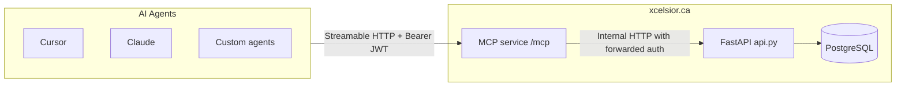
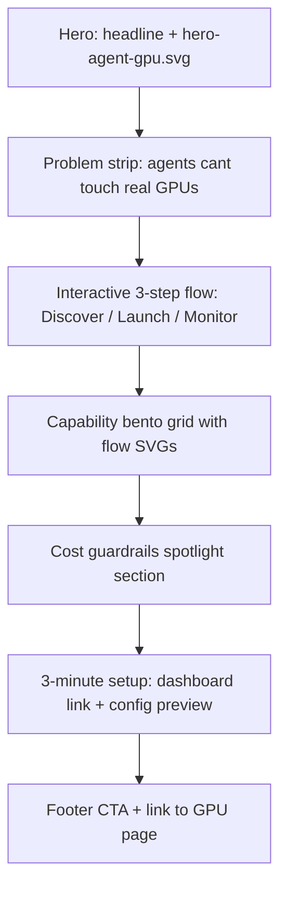
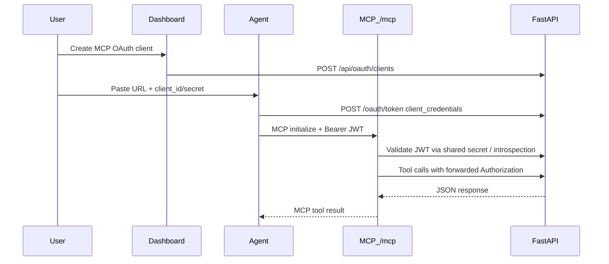

<!-- residency-guard: documents-removal — delivered v1/v2 build plan, superseded by the tool-surface plan -->
> Build a hosted Streamable HTTP MCP server at `https://xcelsior.ca/mcp` as v1 (user-chosen critical path), exposing curated agent-native tools over the full Xcelsior platform API with OAuth M2M auth, dashboard setup UX, marketing landing page, and battle-tested CI. Stdio npm package ships in v2.

# Xcelsior MCP Server — Production Plan

## Strategic positioning

Xcelsior already documents MCP intent in [fern/pages/llm-integration.mdx](fern/pages/llm-integration.mdx) and ships OAuth M2M clients in [frontend/src/components/settings/OAuthClientManager.tsx](frontend/src/components/settings/OAuthClientManager.tsx), but **no MCP server exists** ([wizard/src/agent-context.ts](wizard/src/agent-context.ts) explicitly says "We don't ship an MCP"). This feature closes that gap and becomes the **agent-native control plane** for compute, billing, serverless, and monitoring.

**v1 transport (per your choice):** Hosted **Streamable HTTP** at `https://xcelsior.ca/mcp` — agents connect with URL + Bearer token, no local install.

**v2:** Stdio package `@xcelsior-gpu/mcp` (`npx`) sharing the same tool layer.



---

## Marketing copy — picks and rationale

| Placement | Copy | Why |
|-----------|------|-----|
| **MCP landing headline** | **Let AI agents control real GPUs.** | Concrete, verifiable claim (not hype). Matches the product exactly. Strong SEO + instant comprehension. |
| **MCP landing subheadline** | **Xcelsior MCP turns natural language into compute — instantly, securely, and globally.** | Adds brand, trust (securely), and scale (globally). Balances headline specificity with premium tone. |
| **Category / About / investor one-liner** | **The missing backend for agentic AI.** | Best differentiation line — positions Xcelsior as infrastructure, not "another GPU marketplace." Use where you need thought-leadership, not feature explanation. |
| **GPU availability page CTA** | **Natural language to real GPUs. Zero friction.** | Short, action-oriented; fits beside existing GPU fleet marketing in [frontend/src/app/(marketing)/gpu-availability/content.tsx](frontend/src/app/(marketing)/gpu-availability/content.tsx). |
| **Dashboard MCP setup card** | **From prompt to compute in seconds.** | Operational, reassuring for users configuring credentials — emphasizes speed after setup. |
| **Docs / Fern llm-integration** | **Give your AI agents direct access to a global GPU network.** | Educational tone; pairs well with setup instructions and OAuth steps. |

**Deprioritized:** "Tell an AI what you need. It just happens." — too vague for a technical buyer; "spin up GPUs with one sentence" — good for social, weak for landing hero.

---

## Code structure (hosted v1)

New package at repo root: **`mcp/`** (sibling of [wizard/](wizard/)), deployed as its own container/process behind Caddy/nginx at `/mcp`.

```
mcp/
├── package.json                 # @xcelsior-gpu/mcp-server (private deploy pkg v1)
├── tsconfig.json
├── Dockerfile
├── README.md
├── src/
│   ├── index.ts                 # HTTP server entry, health, metrics
│   ├── transport/
│   │   └── streamable-http.ts   # MCP Streamable HTTP handler (POST /mcp, GET /mcp)
│   ├── server.ts                # McpServer init, register tools/resources/prompts
│   ├── config.ts                # XCELSIOR_API_URL, bind host/port, rate limits
│   ├── auth/
│   │   ├── bearer.ts            # Extract + validate Bearer from MCP HTTP session
│   │   └── scopes.ts            # Tool → required scope map
│   ├── client/
│   │   ├── api.ts               # Typed fetch wrapper → xcelsior.ca API
│   │   └── errors.ts            # HTTP 4xx/5xx → agent-readable MCP errors
│   ├── tools/
│   │   ├── index.ts
│   │   ├── discovery.ts         # list_available_gpus, search_marketplace, get_spot_prices
│   │   ├── compute.ts           # create_instance, list_instances, get_instance, cancel_instance
│   │   ├── serverless.ts        # list_endpoints, deploy_endpoint, run_inference, get_job_status
│   │   ├── billing.ts           # get_wallet, estimate_cost, list_invoices
│   │   ├── trust.ts             # get_reputation, get_host_telemetry
│   │   ├── workflows.ts         # run_training_job, schedule_under_budget (composite)
│   │   └── guardrails.ts        # should_i_run_this (estimate + wallet + jurisdiction warnings)
│   ├── resources/
│   │   ├── llms-txt.ts          # xcelsior://docs/llms
│   │   └── pricing.ts           # xcelsior://pricing/reference (cached)
│   ├── prompts/
│   │   └── playbooks.ts         # "cheapest A100", "CA-only fine-tune", etc.
│   └── lib/
│       ├── polling.ts             # wait_for_instance, wait_for_job
│       ├── jurisdiction.ts        # CA residency hints from platform docs
│       └── format.ts              # Consistent JSON summaries for agents
└── tests/
    ├── unit/                      # Tool schema + handler mocks (vitest)
    ├── integration/               # Against pytest API fixtures / staging
    └── contract/                  # Tool input/output ↔ OpenAPI shapes
```

**v2 addition (same `tools/` layer):** `src/stdio.ts` — stdio transport entry reusing identical tool registrations.

**Key dependency:** `@modelcontextprotocol/sdk` + `zod` for tool schemas. HTTP to API via native `fetch` (or thin wrapper over [@xcelsior-gpu/sdk](frontend/sdk/) types for parity).

---

## Tool surface (curated, not raw OpenAPI dump)

Agents work better with **~20 high-level tools** than 79 raw REST operations. Group by capability:

### Tier 1 — Discovery (read-only, no spend)
| Tool | Maps to |
|------|---------|
| `list_available_gpus` | `GET /api/v2/gpu/available` |
| `search_marketplace` | `POST /api/v2/marketplace/search` |
| `get_spot_prices` | `GET /api/v2/marketplace/spot-prices` |
| `get_pricing_reference` | `GET /api/pricing/reference` |
| `list_tiers` | `GET /tiers` |

### Tier 2 — Compute lifecycle
| Tool | Maps to |
|------|---------|
| `create_instance` | `POST /instance` ([JobIn](routes/instances.py) — supports `git_repo`, `init_script`, `pricing_mode: spot`) |
| `list_instances` / `get_instance` | `GET /instances`, `GET /instance/{id}` |
| `cancel_instance` / `terminate_instance` | cancel + terminate routes |
| `get_instance_logs` | `GET /instances/{id}/logs` |

### Tier 3 — Serverless
| Tool | Maps to |
|------|---------|
| `list_serverless_endpoints` | `GET /api/v2/serverless/endpoints` |
| `create_serverless_endpoint` | `POST /api/v2/serverless/endpoints` |
| `run_serverless_job` | `POST /v1/serverless/{id}/run` or `/runsync` |
| `get_serverless_job_status` | `GET /v1/serverless/{id}/status/{job_id}` |

### Tier 4 — Billing & guardrails
| Tool | Maps to |
|------|---------|
| `get_wallet_balance` | `GET /api/billing/wallet/{customer_id}` |
| `estimate_job_cost` | `POST /api/pricing/estimate` ([estimate_job_cost](reputation.py)) |
| **`should_i_run_this`** | Composite: estimate + wallet + optional `max_hourly_cad` + jurisdiction note → `{approved, reasons, estimated_cost}` |
| `list_invoices` | `GET /api/billing/invoices/{customer_id}` |

### Tier 5 — Standout agent-native workflows
| Tool | Behavior |
|------|----------|
| **`run_training_job`** | `create_instance` with `git_repo` + `image` + `gpu_model` + `init_script`, then `wait_for_instance` until `running`, return connection info + logs tail |
| **`schedule_under_budget`** | Poll `list_available_gpus` + spot prices until match under `max_hourly_cad`, then `create_instance` (optional `pricing_mode: spot`) |
| **`watch_instance`** | Poll `get_instance` + `get_instance_logs` + host telemetry for N minutes; summarize GPU util if available |

Destructive tools (`create_instance`, `terminate_instance`, `create_serverless_endpoint`) include **`confirm: boolean`** in schema; when false, return preview only (cost estimate + config) — implements cost guardrails without a new backend approval system in v1.

---

## Backend changes required

The MCP service proxies to the existing API, but several **platform gaps** must close for production agents:

### 1. Extend OAuth scopes
Add to `scopes_supported` in [routes/auth.py](routes/auth.py) and dashboard scope UI in [OAuthClientManager.tsx](frontend/src/components/settings/OAuthClientManager.tsx):
- `gpu:read` (already enforced in [routes/gpu.py](routes/gpu.py) but missing from OAuth metadata)
- `events:read` (for [routes/events.py](routes/events.py) audit trail)
- `marketplace:read` (wizard already references this; wire into auth metadata)

Default MCP client preset scopes: `instances:read`, `instances:write`, `billing:read`, `gpu:read`, `marketplace:read`.

### 2. Expand public OpenAPI allowlist
Update [scripts/generate_public_openapi.py](scripts/generate_public_openapi.py) `CLIENT_OPERATION_ALLOWLIST` to include agent-critical routes currently missing:
- `GET /api/v2/gpu/available`
- `GET /api/reputation/{entity_id}`
- `GET /api/telemetry/all` or new user-scoped telemetry route
- Instance lifecycle: `POST /instances/{id}/terminate`, `/start`, `/stop`
- `GET /api/events/{entity_type}/{entity_id}`

Regenerate: `python3 scripts/generate_public_openapi.py`

### 3. User-scoped telemetry (new route)
`GET /agent/telemetry/{host_id}` is provider-oriented. Add **`GET /api/instances/{job_id}/telemetry`** in [routes/instances.py](routes/instances.py) or [routes/agent.py](routes/agent.py):
- Resolve job → host_id
- Return latest GPU util / VRAM from `_host_telemetry`
- Scope: `instances:read`
- Powers `watch_instance` tool

### 4. MCP route mounting + infra
- Deploy `mcp/` container; Caddy route `xcelsior.ca/mcp` → MCP service
- Add `/mcp` to rate-limit exemptions or dedicated limiter (agents poll heavily)
- Add `GET /mcp/health` for readiness
- OTEL: span per tool call with `mcp.tool.name` attribute (aligns with existing OTEL in [api.py](api.py))

### 5. Fix stale agent docs
Update [llms.txt](llms.txt): `/job` → `/instance`, document MCP endpoint, OAuth bootstrap flow, scope list.

---

## UI & design vision (premium — above GPU page bar)

MCP is a **flagship differentiator**; the landing page and dashboard setup must feel like a product launch, not a docs appendix. Match and exceed the energy of [gpu-availability/content.tsx](frontend/src/app/(marketing)/gpu-availability/content.tsx) and [xcel-ai-onboarding.tsx](frontend/src/components/ai/xcel-ai-onboarding.tsx), with a distinct **agent-bridge** visual language: neural pathways, tool-call flows, and GPU nodes connected by light trails.

### Design language

| Element | Treatment |
|---------|-----------|
| **Palette** | Existing brand gradient (`#00d4ff` → `#7c3aed` → `#dc2626`) on `#0a0e1a`; MCP accent = violet + cyan (agent intelligence), gold for cost/guardrails |
| **Typography** | Tight tracking on headlines; monospace only for config snippets and tool names |
| **Motion** | Framer `fadeUp` stagger (GPU page pattern); hero has slow-pulse connection lines; settings uses `StaggerList` |
| **Density** | Landing = spacious editorial sections; settings = focused wizard, not another OAuth form dump |
| **Differentiation** | GPU page sells hardware; MCP page sells **agent → platform → GPU** flow (3-node story) |

### Python asset pipeline (killer SVGs)

New script: **`scripts/generate_mcp_page_svgs.py`** — same pattern as [generate_gpu_page_svgs.py](scripts/generate_gpu_page_svgs.py) and [generate_ai_onboarding_svgs.py](scripts/generate_ai_onboarding_svgs.py).

Output → `frontend/public/mcp/`:

| Asset | Visual concept |
|-------|----------------|
| `hero-agent-gpu.svg` | Agent orb (sparkle) → MCP gateway hex → GPU die; animated-style dashed paths, glow filters |
| `flow-discover.svg` | Magnifying glass over GPU grid + price tags |
| `flow-launch.svg` | Terminal prompt morphing into running instance card |
| `flow-guardrails.svg` | Shield + wallet + estimate meter (cost gate) |
| `flow-monitor.svg` | Live telemetry waveform on GPU die |
| `agent-cursor.svg` / `agent-claude.svg` / `agent-vscode.svg` | Minimal brand-neutral agent icons for setup tabs (not official logos — abstract terminal/chat/editor glyphs) |
| `settings-hero.svg` | Compact banner for dashboard MCP section (480×160) |
| `og-mcp-card.svg` | 1200×630 OG image for `/mcp` social share |

Run in CI / `prebuild`: `python3 scripts/generate_mcp_page_svgs.py` (wire into frontend build or document in README).

### Marketing landing page — `/mcp`

**Files:**
- [frontend/src/app/(marketing)/mcp/page.tsx](frontend/src/app/(marketing)/mcp/page.tsx) — metadata, OG
- [frontend/src/app/(marketing)/mcp/content.tsx](frontend/src/app/(marketing)/mcp/content.tsx) — client component (mirror GPU page split)
- [frontend/src/app/(marketing)/mcp/layout.tsx](frontend/src/app/(marketing)/mcp/layout.tsx) — optional aurora wrapper

**Page structure (7 sections, scroll narrative):**



1. **Hero** — `AuroraBackground`, headline/subheadline (marketing picks), primary CTA "Connect your agent" → `/dashboard/settings?tab=mcp`, secondary "View tools" anchor. Live stat pills if API up: GPU count from `/api/v2/gpu/available`, "20+ agent tools".
2. **Problem strip** — single line: "The missing backend for agentic AI." + 3 pain bullets (no GPU access, no cost visibility, no monitoring loop).
3. **Flow section** — horizontal stepper (mobile: vertical) with `flow-*.svg` illustrations; each step has one example natural-language prompt ("Spin up 4× RTX 4090 for fine-tuning under $2/hr").
4. **Bento capability grid** — 2×3 cards: Discovery, Compute, Serverless, Billing, Guardrails, Monitoring — icon + one-liner + tool count badge; hover lifts card (GPU page `HeroStat` energy).
5. **Guardrails spotlight** — full-width band, `flow-guardrails.svg`, explains `should_i_run_this` + `confirm` gate; gold accent.
6. **Setup section** — tabbed config snippets (Cursor / Claude / VS Code) with syntax-highlighted JSON; blurred token placeholder; "Create credentials in dashboard" button.
7. **CTA** — cross-link GPU availability page with tagline "Natural language to real GPUs. Zero friction."

**i18n:** [en-public.ts](frontend/src/lib/i18n/en-public.ts), [fr-public.ts](frontend/src/lib/i18n/fr-public.ts) — all copy keys prefixed `mcp.landing.*`.

**Nav:** Add "MCP" to marketing header nav (between GPU and Docs or under Products dropdown).

### Dashboard — "Connect AI Agents" (Settings)

Not a bolt-on inside OAuth tab — a **dedicated premium section** (new settings sub-tab `mcp` or top-level card above OAuth clients in API tab).

**Files:**
- [frontend/src/components/settings/McpAgentSetup.tsx](frontend/src/components/settings/McpAgentSetup.tsx) — main component (~400 lines, self-contained)
- [frontend/src/components/settings/mcp-config-snippet.tsx](frontend/src/components/settings/mcp-config-snippet.tsx) — tabbed snippets + copy
- [frontend/src/components/settings/mcp-setup-wizard.tsx](frontend/src/components/settings/mcp-setup-wizard.tsx) — 4-step inline wizard
- Wire into [settings/page.tsx](frontend/src/app/(dashboard)/dashboard/settings/page.tsx) — new tab `{ id: "mcp", icon: Bot, color: "text-accent-violet" }` or prominent section in `api-keys` tab

**Visual layout:**

```
┌─────────────────────────────────────────────────────────────┐
│ [settings-hero.svg banner]  From prompt to compute in secs  │
├─────────────────────────────────────────────────────────────┤
│  Setup wizard (4 steps)          │  Live preview panel      │
│  ① Create MCP client            │  Cursor config JSON      │
│  ② Copy client ID/secret          │  (updates as you go)   │
│  ③ Get bearer token              │                          │
│  ④ Paste into agent              │  Connection test btn   │
├─────────────────────────────────────────────────────────────┤
│  Scope chips (instances, billing, gpu…)   [Manage clients]  │
├─────────────────────────────────────────────────────────────┤
│  Tool reference accordion (collapsible, not wall of text)   │
└─────────────────────────────────────────────────────────────┘
```

**UX details:**
- **Step wizard** with progress rail; completed steps get green check (reuse onboarding step pattern from [xcel-ai-onboarding.tsx](frontend/src/components/ai/xcel-ai-onboarding.tsx))
- **One-click "Create MCP client"** — calls `createOAuthClient` with preset scopes + name `mcp-agent-<date>`; opens [OAuthSecretRevealModal](frontend/src/components/settings/oauth-secret-reveal-modal.tsx)
- **Token helper** — inline `curl` one-liner to `POST /oauth/token` with copy button; optional "Test connection" calls MCP health or `list_available_gpus` via dashboard proxy
- **Agent tabs** — Cursor / Claude Desktop / VS Code / Custom; each shows exact JSON config with user's URL pre-filled
- **Scope panel** — reuse [credential-scope-panel.tsx](frontend/src/components/settings/credential-scope-panel.tsx) with MCP-specific descriptions
- **Empty state** — `settings-hero.svg` + compelling copy when no MCP client exists yet
- **i18n:** `dash.settings.mcp.*` in [en.ts](frontend/src/lib/i18n/en.ts) / [fr.ts](frontend/src/lib/i18n/fr.ts)

### Cross-app touches

| Surface | Change |
|---------|--------|
| GPU availability page | Banner card linking to `/mcp` with CTA copy |
| Dashboard home | Optional "Connect an AI agent" onboarding chip (dismissible) |
| Xcel AI panel | Mention MCP in onboarding slide 4 or link to settings |
| Fern / llms.txt | Setup guide + link to `/mcp` |

### UI quality bar (acceptance criteria)

- Landing Lighthouse accessibility ≥ 90; no layout shift on hero image load
- All SVGs generated from Python script (no hand-drawn one-offs drifting from brand)
- Settings MCP wizard completable in &lt; 60s with copy-paste only (no manual JSON editing)
- Visual regression: Playwright screenshot tests for `/mcp` and settings MCP tab
- FR parity for all new strings

### Wizard alignment (v2)
Update [wizard/src/agent-context.ts](wizard/src/agent-context.ts) to mention hosted MCP alongside CLI context.

### Fern docs
Expand [fern/pages/llm-integration.mdx](fern/pages/llm-integration.mdx) with screenshots from generated assets and link to `/mcp`.

---

## Auth & security model



- **Never** accept `XCELSIOR_API_TOKEN` (master admin) via MCP
- Per-tool scope enforcement in MCP layer **before** calling API (defense in depth)
- Audit log: append user audit event on destructive tool calls (`append_user_audit_event` pattern from instances routes)
- Rate limit: 60 tool calls/min per OAuth client (configurable)

---

## Testing strategy (battle-tested)

| Layer | What | Where |
|-------|------|-------|
| **Unit** | Tool Zod schemas, scope gating, error mapping, `should_i_run_this` logic | `mcp/tests/unit/` vitest |
| **Contract** | Each tool's request/response shapes match OpenAPI schemas | `mcp/tests/contract/` |
| **Integration** | MCP HTTP transport against running API with test OAuth client | `mcp/tests/integration/` + reuse patterns from [tests/test_api.py](tests/test_api.py) |
| **Backend** | New telemetry route, scope metadata, allowlist regression | `tests/test_mcp_platform.py` (new) |
| **E2E manual** | MCP Inspector (`npx @modelcontextprotocol/inspector`) against staging | Runbook in `mcp/README.md` |
| **CI** | New `.github/workflows/mcp.yml`: build, test, docker build; gate on PR | |

**Staging smoke script:** `scripts/mcp_smoke.py` — token → list GPUs → estimate cost → dry-run create_instance (`confirm: false`).

---

## Implementation phases

### Phase 1 — Hosted MCP skeleton (week 1)
- Scaffold `mcp/` package, Streamable HTTP transport, health endpoint
- Auth: Bearer validation by calling `GET /api/auth/me` or local JWT verify (same HS256 as [oauth_service.py](oauth_service.py))
- 5 read-only tools: `list_available_gpus`, `get_spot_prices`, `get_wallet_balance`, `list_instances`, `estimate_job_cost`
- Docker + Caddy route; deploy to staging

### Phase 2 — Compute + guardrails (week 2)
- Write tools: `create_instance`, `cancel_instance`, `should_i_run_this` with `confirm` gate
- Composite: `run_training_job`, `schedule_under_budget`
- Backend: telemetry route, scope expansion, OpenAPI allowlist update

### Phase 3 — Serverless + monitoring (week 3)
- Serverless tool group
- `watch_instance` polling tool
- Resources (`llms.txt`, pricing) + prompt playbooks

### Phase 4 — Product polish + premium UI (week 4)
- `scripts/generate_mcp_page_svgs.py` → `frontend/public/mcp/*.svg` (8 assets)
- Marketing `/mcp` landing (7-section narrative, bento grid, guardrails spotlight, live stats)
- Dashboard `McpAgentSetup` 4-step wizard + config snippet tabs + connection test
- i18n EN/FR, nav link, GPU page cross-promo, Playwright visual regression
- Fern docs, llms.txt update
- Full CI + staging smoke + production launch

### Phase 5 (v2) — Stdio package
- `npx @xcelsior-gpu/mcp` sharing `tools/` layer
- npm publish in [.github/workflows/publish.yml](.github/workflows/publish.yml)

---

## Success criteria

- Agent can connect to `https://xcelsior.ca/mcp` from Cursor with OAuth token and list GPUs within 30s of dashboard setup
- `should_i_run_this` returns cost + wallet sufficiency before any spend
- `run_training_job` completes end-to-end on staging (instance reaches `running`, logs accessible)
- 90%+ unit test coverage on tool handlers; integration suite green in CI
- Zero master-token exposure; all actions scoped to user's OAuth client
- `/mcp` landing and settings MCP wizard meet premium UI bar: Python-generated SVGs, 7-section narrative, 4-step wizard, Playwright snapshots pass, EN/FR complete

## Todos

- [x] **scaffold-mcp-package** — Create mcp/ package with Streamable HTTP transport, auth, API client, Docker + Caddy /mcp route
- [x] **tier1-read-tools** — Implement discovery + billing read tools (GPUs, spot prices, wallet, estimate, list instances)
- [x] **backend-gaps** — Expand OAuth scopes, OpenAPI allowlist, add /api/instances/{id}/telemetry, fix llms.txt
- [x] **compute-guardrails** — Add create/cancel instance tools with confirm gate, should_i_run_this, run_training_job, schedule_under_budget
- [x] **serverless-monitoring** — Serverless tool group + watch_instance + MCP resources/prompts
- [x] **mcp-assets** — Python SVG generator (scripts/generate_mcp_page_svgs.py) + public/mcp/ brand assets
- [x] **dashboard-landing** — Premium /mcp landing (7 sections, bento, guardrails) + McpAgentSetup wizard + i18n + visual regression + Fern docs
- [x] **testing-ci** — vitest unit/contract/integration tests, test_mcp_platform.py, mcp.yml CI, staging smoke script
- [x] **v2-stdio** — v2: stdio transport + npm publish @xcelsior-gpu/mcp reusing shared tools/
- [x] **deploy-mcp** — Nginx route `xcelsior.ca/mcp` → MCP container (docker-compose `mcp` service)
- [x] **visual-regression** — Playwright snapshots for `/mcp` and settings MCP tab
