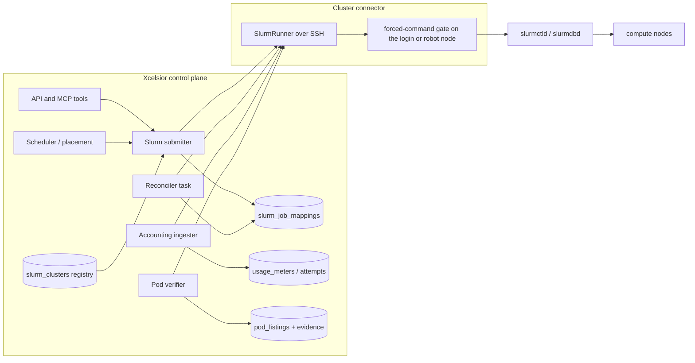

# Slurm adapter and pod tier: production implementation plan

Status as of 2026-11-07 (updated the same day: Alliance facts verified against the official docs, decisions D1–D6 made, admin HPC dashboard fixed; updated 2026-11-08: Phase 0 hardening and the research corrections in §5a). Owner: Aaryn Biro. Audience: whoever implements it, human or agent.

**The claim this plan makes true:** "Slurm schedules GPUs inside a cluster. Xcelsior schedules across clusters." Xcelsior is the meta-scheduler: one control plane that submits into Slurm-run clusters, Kubernetes facilities and independent hosts through one marketplace. Public wording stays "Slurm-native, integration-ready" until a partner route lands.

The local two-node validation kit is in [slurm-local/](slurm-local/README.md). Phase 1 below is that kit.

---

## 1. Where things stand (verified)

### 1.1 What existed before this change (adapter v2.2)

`workers/slurm_adapter.py` turned a job dict into an sbatch script and shelled out to `sbatch`, `squeue`, `sacct` and `scancel` **on whatever machine ran it**. It was reachable from an admin-only API route (`/api/slurm/*` in `api/routes/health.py`), the CLI (`xcelsior slurm-submit`) and the admin HPC dashboard page. It had never run against a real Slurm controller. Reading it and then running it against one found 25 defects; the full list is in the appendix. The ones that matter most:

- It could not express a CPU job, a payload command or a node target. It could not return output or report start/end times. Four of the six local validation cases were impossible to write against it.
- **Reconcile crash.** Any PENDING job raised `CheckViolation` and aborted the whole reconcile pass. The adapter wrote its job state `queued` into `slurm_job_mappings.observed_state`, whose constraint (migration 067) does not allow it. A regression test fails on the old code with exactly that error and passes on the new code.
- **Command injection.** Job name, tier, extra env and image were interpolated raw into the generated script. Through the admin API, that was command injection on the target cluster.
- **Wrong final state.** `sacct` reports `CANCELLED by <uid>`, which mapped to `failed`. Every cancelled job read as failed once it left controller memory.
- **First job always failed.** Output went to a directory the script created *after* Slurm had already opened the output file. The first job on every node failed.
- **Bad profiles.** The `generic` profile requested `gpu:gpu:N`, which no cluster matches. The `nibi` profile described 4 × A100 per node; Nibi is an H100 cluster (288 H100, 8 per node). Unknown profile names silently fell back to `generic`.
- **Lying cancel.** Slurm 25.11's plain `scancel` exits 0 and prints nothing for unknown or aged-out ids, so cancel "succeeded" on any id. The container rehearsal found this.

### 1.2 What this change delivers (adapter v3.0, phase 0)

Done, unit-tested (111 adapter tests, 14 pod tests, 2 new database regression tests) and run end to end against a real Slurm 25.11 cluster in the container rehearsal. All 24 suite cases passed, including the optional SYNC-1 against the pytest database. The pyright gate is at 0 under Python 3.12.

- **Transport.** `SlurmRunner` runs commands locally or over SSH, with the script on stdin and one quoted argv per connection. A forced-command gate, `xcl-slurm-gate`, allowlists exactly those shapes. This is the access model of Alliance automation ("robot") nodes: restricted key, `from=`, `command=`.
- **Profiles.** Operators add profiles through `XCELSIOR_SLURM_PROFILES_FILE`, and unknown names are errors. Profiles now carry:
  - typed or untyped GRES;
  - a CPU partition;
  - a `qos` switch;
  - memory scaling;
  - default and maximum walltime;
  - an output directory;
  - an SSH host;
  - a `cluster_id`, now stored on every mapping.
- **Job spec.** New fields: `command`, `num_gpus: 0` for CPU jobs, `nodelist`, `partition`, `cpus`, `mem_gb` and `walltime`. Every directive value is validated, every shell value is quoted, and `--comment xcelsior:<id>` makes jobs findable after a crash.
- **Errors.** Every failure carries a machine-readable `error_code`: `unsatisfiable_request`, `invalid_partition`, `invalid_nodelist`, `invalid_gres`, `walltime_exceeds_limit`, `transport_error`, `not_found`, `already_terminal`, `invalid_job_spec`, `unknown_profile` and others.
- **States.** The full Slurm state list is mapped. `CANCELLED by <uid>` is normalised, and anything unknown maps to `unknown`, never a guess. A projection onto the database's observed-state vocabulary ends the CheckViolation. The reconcile routes each mapping through its cluster's profile, and one failing row no longer stops the pass.
- **Metering.** `get_slurm_job_accounting()` returns epoch `submitted_at`, `started_at` and `completed_at`, `duration_sec` (ElapsedRaw), `gpu_count`, `gpu_seconds` and `billable`. `accounting_to_meter_fields()` projects that onto `billing.UsageMeter`.
- **Output.** `get_slurm_job_output()` reads the tail of stdout or stderr through the transport.
- **Pod data model.** `workers/slurm_pod.py` builds a pod spec (`xcelsior.pod/v0`) from scheduler inventory, probe jobs and facility declarations. Each field carries provenance: observed or declared, the method, and the Slurm job id as evidence. `verify_pod_spec()` rejects overclaims.
- **Alliance profiles, verified.** The `nibi` and `narval` profiles were checked against docs.alliancecan.ca and against Alliance's own automation wrapper (`slurm_commands.sh`). See §3 P3.1 for what that changed.
- **Admin HPC dashboard fixed.** The page and its API contract now agree: submit, preview, cancel, refresh and the job list all work, and the page is admin-only like its routes.
- **Wiring.** The API route and CLI file mappings under the profile's `cluster_id`. The CLI accepts file profiles. The module imports without the database stack.

### 1.3 Known gaps left open on purpose

Resolved since this plan was first written: the broken HPC dashboard, the QoS default (decision D6), the unverified Alliance profiles, and the two locally failing Prometheus tests. The tests failed because a local `.env.test` set `GUNICORN_WORKERS=2`; `tests/conftest.py` now pins 1.

Still open, each placed in a phase below:

1. **`register_slurm_job` still re-points an open mapping.** `ON CONFLICT (xcelsior_job_id) DO UPDATE SET slurm_job_id = …` re-points a non-terminal mapping at a new Slurm id, which contradicts its own docstring. → P2.2
2. **Polling cost.** Reconcile polls one `squeue` per job, which means N SSH round trips per tick. Alliance also asks that scripts not poll `squeue` every few seconds. → P2.3
3. **No `preempted` observed state.** The constraint lacks it, so a preempted job projects to `cancelled` (terminal). Decision D2 adds it in P2.1's migration.
4. **Untested container paths.** The Docker runtime path escapes the job cgroup, and the Apptainer path has never run. → P2.7
5. **Alliance automation is not for AI agents.** Alliance states its automation nodes "are not suitable for usage of AI agents". Agent-originated bookings must never be routed to an Alliance cluster. → P3.2

---

## 2. Target architecture

**Principles:**

- **The cluster is authoritative for its own state; Xcelsior is authoritative for intent.** Xcelsior records `desired_state`, observes `observed_state` and reconciles the two. It never infers a job's fate from silence.
- **Every remote action is one allowlisted command over one restricted key.** No interactive shells, no agent forwarding, no ad-hoc scripts on the partner's login node.
- **Billing time comes from the cluster's accounting (slurmdbd), not from Xcelsior's polling clock.** Polling lag must never change a bill.
- **The partner keeps its scheduler, its hardware and its policy.** The adapter adapts to the site, never the reverse.
- **Every spec on a pod listing is either observed by a scheduler-run job, with the job id as evidence, or labelled as declared by the facility.**

---

## 3. Phases

Sizes: S ≈ 1–2 days, M ≈ 3–5 days, L ≈ 1–2 weeks of focused work. Each phase ends with an exit gate.

### P0: adapter correctness (done in this change)

See §1.2. Exit gate: done.
- Unit tests green.
- DB regression proven on old code.
- Rehearsal: 24/24 cases, SYNC-1 included.
- Pyright gate at 0.

### P1: local two-node validation (done 2026-11-07)

Ran `slurm-local/` on the real tower and ASUS. V-1 to V-12 passed, and all 24 suite cases passed, SYNC-1 included. Docker and the runners were unchanged. The results are in `slurm-local/RESULTS_2026-11-07.md` and the evidence in `slurm-local/evidence/r1107050537/`. The cluster stays installed, with services disabled at boot. The real run found three kit defects that the containers had hidden, all fixed: a SIGPIPE false failure in preflight, an empty untouchables snapshot, and an `~/.ssh/config` alias whose `Host *` key bypassed the restricted key.

Exit gate:
- `CHECKLIST.md` sections A–C all PASS (SYNC-1 optional);
- rollback verified on both machines (section D), or the cluster kept running by choice;
- `RESULTS_TEMPLATE.md` filled in from the run's `results.json`.

Watch-outs:
- The ASUS's hardware crashes can take a node DOWN mid-run. Re-run the affected case with `--only` before calling it an adapter failure.
- The tower is production-adjacent. The kit caps Slurm at 8 GB and 8 CPUs on it in total, starts nothing at boot and proves Docker and the runners unchanged (V-12). Its GPU is shared with services outside Slurm (MPS, pxl-publisher, a GPU test worker, a Docker container), found 2026-11-08.

### P2: control-plane integration (the production path)

This turns the adapter from an admin tool into a placement target for real jobs. Everything here runs in the control plane on prod and reaches clusters only through the connector.

#### P2.1 Cluster registry (M, needs a migration)

- Add a table `slurm_clusters` with these columns:
  - `cluster_id` (PK), `display_name`, `profile` (JSONB, the same keys as today's profile dicts), `ssh_host` and `ssh_port`;
  - `known_hosts_line` (the pinned host key, never trust-on-first-use);
  - `credential_ref` (a Vaultwarden / secret-store reference, never the key itself);
  - `remote_user`, `status` (`active | paused | retired`), `owner_org`, `created_at` and `updated_at`.
- `available_profiles()` reads the registry. Built-ins and the JSON file become seed data and a dev override.
- `get_runner()` builds SSH options from the registry: `-F <generated config> -o UserKnownHostsFile=<tmp pinned file> -o StrictHostKeyChecking=yes -i <materialised key> -o IdentitiesOnly=yes -o IdentityAgent=none`. The key is materialised to a 0600 tmpfs file for the call's lifetime. Never let the service user's `~/.ssh/config` apply. IdentityFile entries accumulate across Host blocks, so a `Host *` key gets offered first. On the local run that let an unrestricted key in.
- Admin API for CRUD, plus a "test connection" action that runs `sinfo --version` and `scontrol show config` through the gate.
- Bookkeeping per `CONTRIBUTING`/memory rules: a domain claim in `control_plane/db_roles.py`, `EXPECTED_HEAD` bumps, and the migration applied to both the dev and pytest databases.
- Acceptance: the adapter never reads a profile from code in production, and `cluster_id` on every mapping is a foreign key to `slurm_clusters`.

#### P2.2 Submission inside the job lifecycle (L)

- A Slurm cluster becomes a placement target alongside hosts. The scheduler creates a `job_attempts` row (migration 055) whose target is `slurm:<cluster_id>`, then calls the submitter.
- **Idempotent submit:**
  1. The submit key is `attempt_id`.
  2. Before any `sbatch`, look for an existing job carrying `--comment xcelsior:<job_id>`: `squeue --me -h -o "%i %k"`, then `sacct -X -n -o JobID,Comment` (needs `AccountingStoreFlags=job_comment` on the site, or fall back to `JobName=xcl-<job_id>`).
  3. If one exists, register it instead of resubmitting.
  4. This closes the crash window between `sbatch` and the mapping insert.
- Fix `register_slurm_job` so that a conflict on an open mapping with a *different* Slurm id raises, rather than re-pointing. The same id is a no-op. Always pass `tenant_id` and `attempt_id`, so the existing unique indexes do their job.
- Every remote failure maps to an attempt outcome:
  - `error_code` in {`unsatisfiable_request`, `invalid_*`, `walltime_exceeds_limit`} → attempt `rejected` (terminal, not retried);
  - `transport_error`, `timeout`, `controller_unreachable` → retry with backoff, then `lost`.
- Acceptance tests:
  - a crash injected between `sbatch` and register leaves exactly one Slurm job and one mapping after recovery;
  - a retried submit never creates a second job;
  - rejected requests never retry.

#### P2.3 Reconciler as a durable scheduled task (M)

- Register it through `control_plane.scheduled_tasks.register_task(..., service=...)` under its own database identity. It runs every 15–30 s per active cluster.
- **Batch per cluster:** one `squeue -h -j <id,id,…> -o %i|%T|%R` plus one `sacct -X -n --parsable2 -j <ids> -o JobID,State,…` per tick, instead of one call per job. Chunk at about 200 ids per call. Keep every argument free of spaces and quotes, since site wrappers word-split the command.
- **Interval per profile.** 15–30 s on clusters we run. On Alliance clusters, 60 s or more and sacct-first: their docs ask that scripts not run `squeue` "at high frequency (e.g. every few seconds)". Also respect `MaxSubmit`: 1000 pending or running jobs per account.
- Persist `observed_state` and `last_observed_at` as today. Alert when `last_observed_at` is older than 3× the interval for any open mapping.
- `not_found` handling: if the job is in neither squeue nor sacct for N consecutive ticks, mark the mapping `unknown` and raise an operator event. Never assume it completed.
- Desired → cluster: `desired_state = cancelled` sends `cancel_slurm_job`. Treat `already_terminal` as success.
- Acceptance tests:
  - a load test with 2,000 open mappings on the rehearsal cluster finishes a tick in under 10 s;
  - a controller restart during a tick loses no transition.

#### P2.4 Metering and billing from accounting (L)

- On a terminal transition, the accounting ingester calls `get_slurm_job_accounting()`. It writes or settles the attempt's meter through the existing attempt-billing path (`control_plane/attempt_billing.py`, `billing.settle_attempt_meter`):
  - `started_at` and `completed_at` come from slurmdbd;
  - `duration_sec` is ElapsedRaw;
  - `gpu_seconds` = ElapsedRaw × AllocTRES `gres/gpu`.
- While running, the active meter uses `started_at` and leaves `completed_at = 0.0`, the shape METER-3 proves.
- Rules, each with a test:
  - a job cancelled while pending is never billed (`billable = false`);
  - a timeout bills to its end;
  - a requeued job bills each run segment, which needs `sacct --duplicates`;
  - a preempted job bills to the preemption time.
- Daily reconciliation: sum the day's `sacct` `ElapsedRaw × GPUs` per cluster and compare it with meter rows. Alert on any drift over 1%.
- Pricing comes from the cluster's rate card in the registry. A partner facility has its own rate, distinct from host offers.
- Acceptance: billing a set of rehearsal jobs reproduces `sacct` to the second, and the reconciliation report is clean.

#### P2.5 Output and artifacts (M)

- Shared-filesystem clusters: the adapter reads output through the gate (`tail -c`) and caps it at 64 KiB per fetch. A streaming endpoint pages with an offset (add `tail -c +<offset>` to the gate allowlist with bounds).
- Large artifacts: an `rsync` pull through the site's transfer wrapper (Alliance ships one), into Xcelsior's artifact store with tenant scoping. Retention follows the artifact policy.
- Acceptance: a 100 MB result file arrives intact with its checksum verified, and output from another tenant's job is unreachable.

#### P2.6 API, MCP and UI parity (M)

- New tenant-facing endpoints:
  - `POST /api/v1/hpc/jobs` (command, image, num_gpus, walltime, cluster or pod);
  - `GET /api/v1/hpc/jobs/{id}` (Xcelsior id, never a raw Slurm id);
  - `DELETE` the same path;
  - `GET /api/v1/hpc/jobs/{id}/output`;
  - `GET /api/v1/hpc/clusters`.
- These are scoped to the tenant, not admin-only. Map `error_code` onto HTTP status: 400 `invalid_*`, 409 `already_terminal`, 422 `unsatisfiable_request` or `walltime_exceeds_limit`, 503 `transport_error` or `controller_unreachable`.
- MCP tools `submit_hpc_job`, `get_hpc_job`, `cancel_hpc_job`, `get_hpc_job_output` and `list_hpc_clusters`. They return `error_code` verbatim so agents can branch. Regenerate `mcp/openapi-v1.json` and run `npm run generate:api`.
- Move the HPC dashboard page onto the v1 endpoints. The page itself was fixed on 2026-11-07 against the legacy routes, with a component test (`hpc-page.test.tsx`) and backend contract tests (`TestHpcDashboardContract`) pinning the shared shapes.
- Keep the old `/api/slurm/*` admin routes until the UI moves, then remove them.
- Acceptance: an agent books, polls, cancels and fetches output through MCP alone, and the UI shows the same states as the API.

#### P2.7 Security (M, gates any external cluster)

- **Payload trust (decision D1).** Who may run arbitrary `command`s on a partner cluster, and under whose account?
- **Gate per cluster.** The gate's allowlist is versioned in the repo. Every allow and deny is shipped to the audit log with tenant, job and cluster ids.
- **Keys.** One key per cluster, rotated quarterly. `from=` is pinned to the control plane's egress IPs; the prod Hetzner address must be stable or proxied. Rotation runbook and tested revocation.
- **Containers.** Apptainer only on shared clusters, with `--containall` and no host mounts beyond the job's work dir. Remove the Docker runtime path from non-owned profiles, because it escapes Slurm's cgroups.
- **Secrets** never appear in generated scripts. Pass them through the site's mechanism or not at all.
- Run a `/security-review` and a red-team pass on the script generator (fuzz every job field through `bash -n` and execution in a sandbox).
- Acceptance: the fuzzer finds no field that reaches shell evaluation, and a pen-test of the gate finds no escape.

#### P2.8 Observability (S)

- Metrics: submissions by `error_code`, submit latency, reconcile lag, transport failures per cluster, accounting drift, and the gate deny rate. Wire them into the existing Prometheus and Grafana setup, with alerts on reconcile staleness, transport failures over 5 minutes and drift over 1%.

#### P2.9 Rollout (S)

1. Feature flag `slurm_placement`.
2. **Shadow mode:** the reconciler and accounting ingester run against the local cluster while billing is computed but not charged, and compared for a week.
3. Admin-only.
4. Allowlisted tenants.
5. General availability.

The rollback switch is the flag; mappings stay for audit.

**P2 exit gate:**
- the local cluster is registered as a real cluster in staging;
- jobs placed through the scheduler run, reconcile and bill to the second;
- the MCP round trip works;
- the security review is closed;
- the dashboards are live.

### P3: academic scale validation (research; contingent on a PI and Mitacs)

Nothing here starts until a sponsoring PI exists. Research use only; no commercial workloads on the cluster.

- **P3.1 Profile truth (done 2026-11-07, from the official docs).** These changed the profiles:
  - **Partitions:** Alliance routes each job to a partition from its resources and walltime (by-node or by-core, 3 h to 7 day tiers). The `nibi` and `narval` profiles now omit `--partition`.
  - **GPU requests:** `--gpus-per-node=h100:N`, or `--gpus=h100:N` across nodes. The docs say `--gres=gpu:…` "may not be supported in the future". Profiles gained `gpu_request: "gpus"`. Nibi's MIG names are `h100_1g.10gb`, `h100_2g.20gb` and `h100_3g.40gb`; MIG isn't modelled yet.
  - **Accounts and time:** `--account=def-<pi>` and `--time` are required, and there is no user QoS. Profiles gained `account_required`, and submits without an account return `missing_account`.
  - **Bundles:** Nibi gives each H100 14 cores and 250 GB; Narval gives each A100 12 cores and 124 GB. Profiles set `--cpus-per-gpu` and size memory under the bundle.
  - **Modules:** `cuda/12.2` and `python/3.11` (3.11.2 and 3.11.5) exist; Apptainer is a module, now loaded.
  - **Hardware:** Nibi has 36 nodes of 8 × H100 SXM 80 GB with NVLink, and Nokia Ethernet at 200 Gb/s non-blocking between GPU nodes. Narval has 4 × A100 40 GB per node on InfiniBand HDR. Graham is retired, and submissions to it are refused.
  - **Remaining:** confirm all of this on a real run (P3.3). Model MIG instances, and `--switches=1` for tightly coupled jobs.
- **P3.2 Automation access (S, needs the PI).** The rules, from Alliance's automation page:
  - Access is by request, explaining the exact commands and tools.
  - The key must be uploaded to CCDB, not `authorized_keys`, and carry all three of `restrict`, `from=` and `command=`.
  - `from=` must be a public IP pattern at least as specific as `x.y.z.*`. Prod's egress (46.225.20.97) qualifies.
  - The node is `robot.nibi.alliancecan.ca`.

  Alliance's own `slurm_commands.sh` allows `squeue`, `scancel`, `sbatch`, `scontrol`, `sq`, `sinfo` and `sacct`, plus `cat` and `ls`. It runs `$SSH_ORIGINAL_COMMAND` unquoted, so the adapter now sends only word-split-safe tokens, with no env prefix and output read with `cat`. `TestWordSplitSafeTransport` pins this. **Alliance states that automation nodes "are designed for predictable workloads. They are not suitable for usage of AI agents."** So the research project uses deterministic, scripted adapter traffic only. No MCP or agent-originated submission is ever routed to an Alliance cluster, and the access request must say so.
- **P3.3 Validation runs (M).** Run the same suite with a `nibi` profile at small scale: CPU, 1 GPU and 1 node × 8 GPUs. Add cases for multi-node jobs, requeue/preemption accounting and the NCCL all-reduce probe (P4.2).
- **P3.4 Write-up (S).** The results report is the research output and the proposal's evidence.

Exit gate: the suite passes on Nibi at small scale, and the profile is corrected from observed behaviour.

### P4: pod tier productization

Build on `slurm_pod.py`'s spec. The facility partner brings the hardware and capex; Xcelsior brings orchestration, metering and the agent booking layer.

- **P4.1 Data model (M, migration).** Tables:
  - `pod_listings`: `pod_id`, `cluster_id` FK, `partition` or `reservation`, `status`, `spec` JSONB in `xcelsior.pod/v0`, `listing_title` and `rate_card`;
  - `pod_verifications`: append-only, with `pod_id`, `spec_snapshot`, `checks`, `status`, `probe_job_ids` and `verified_at`.

  A listing is bookable only while its latest verification is `verified` and younger than its re-verification interval.
- **P4.2 Verification pipeline (L).** Probe jobs at onboarding and on a schedule:
  - per-node GPU (NVML);
  - NVLink topology (`nvidia-smi topo -m`, replacing v0's link-count approximation);
  - NIC link speed and RDMA devices (`ibv_devinfo`, `rdma link`);
  - fabric bandwidth with `nccl-tests` all-reduce across all nodes, which verifies "800G per GPU" as achieved bus bandwidth against the declared figure with a tolerance.

  Drift fails verification and suspends the listing with an operator event. The spec version moves to `v1` with the fabric fields.
- **P4.3 Booking model (L, decision D5).** Whole-pod or block bookings map to a Slurm reservation (`scontrol create reservation`, which needs operator rights the partner grants) or a dedicated partition. Jobs submitted under a booking carry `--reservation`. Billing is per pod-hour for the booked window, not per job. There is a cancellation and no-show policy.
- **P4.4 Marketplace surface (M).** Listing pages with each spec's provenance shown ("verified by job 4123 on …" vs "declared by facility"). Book-a-pod in the API, MCP (`list_pods`, `book_pod`, `get_pod_booking`) and UI.
- **P4.5 Partner onboarding (S, contract).** The partner provides:
  - a Slurm account and a robot/automation key path;
  - accounting read access (`sacct` for our jobs);
  - a reservation or partition for bookings;
  - a declared spec sheet;
  - an SLA.

  Xcelsior provides orchestration, metering, payment and the agent booking layer.

Exit gate: one partner pod listed with `verified` status from P4.2 probes, booked end to end through MCP, and billed per pod-hour.

---

## 4. Testing strategy

| Layer | What | Where |
|---|---|---|
| Unit | job translation, quoting, error codes, state maps, accounting parsing, pod spec; Slurm output shapes captured from a real cluster | `tests/test_slurm_adapter.py`, `tests/test_slurm_pod.py` |
| Database contract | mapping constraints, reconcile projection, idempotent register, terminal retention | `tests/test_shared_state_contract.py` |
| Real Slurm, no hardware | the container rehearsal: two nodes, real slurmctld/slurmdbd/MariaDB, GPU via NVML, SSH through the gate; also install and rollback | `hpc/slurm-local/rehearsal/run-rehearsal.sh` |
| Real hardware | the same suite on tower + ASUS | `hpc/slurm-local/tests/validate_adapter.py` |
| Live gates | P2 acceptance cases (crash recovery, batching load, billing to the second) added to `tests/live/`, which skips silently without a cluster; check it before calling a gate unasserted | `tests/live/` |
| Security | field fuzzer through `bash -n` + sandboxed execution; gate allowlist tests | P2.7 |

CI note: GitHub Actions has been billing-locked since about 2026-07-21. Until it unlocks, run lint, black, pyright (Python 3.12 from `uv.lock`) and the Slurm tests locally, and treat a green push as unverified. When CI returns, add the rehearsal as a nightly job; it needs a runner with Docker, and a GPU only for the GPU cases.

---

## 5. Decisions (made 2026-11-07)

These were open questions. Each is now decided on the recommendation below. Any can be revisited; the "Status" column says what is already built on it.

| # | Decision | Chosen | Why | Status |
|---|---|---|---|---|
| D1 | Whose account runs tenant code on a partner cluster | **One Xcelsior service account per partner cluster**, with per-tenant Unix groups for output separation and the strict payload policy of D4. Academic clusters are the exception: there the PI's allocation runs research jobs only, never tenant work | Partners sign one contract with one accountable party. Per-tenant accounts on a partner's cluster would make Xcelsior an identity provider for someone else's site | Shapes P2.1 (`credential_ref` per cluster) and P2.7 |
| D2 | `preempted` as an observed state | **Add it to the constraint** in P2.1's migration | Spot and preemptible capacity need to tell preemption from cancellation. Until then a preempted job projects to `cancelled` and stays terminal | Pending: P2.1 migration |
| D3 | Billing source of truth for Slurm jobs | **slurmdbd accounting** (Start, End, ElapsedRaw) | Polling lag must never move money; ElapsedRaw is exact to the second | Built: `get_slurm_job_accounting`, METER-1..3 |
| D4 | Tenant `command` payloads | **Free-form command inside an allowlisted Apptainer image** on clusters we don't own. On our own clusters, a bare command is allowed for operators | A partner's login and compute nodes run only what their policy allows; the image allowlist is that policy | Shapes P2.6 and P2.7 |
| D5 | Pod booking mechanism | **Slurm reservations** (`scontrol create reservation`) | Time-boxed, native to Slurm, and they leave the partner's partitions alone | Shapes P4.3 |
| D6 | `--qos` on built-in profiles | **Off by default**, on per cluster where the site defines QoS | Clusters reject QoS names they don't define; Alliance has no user QoS | Built: `qos: False` default; `qos: True` opt-in |

## 5a. Corrections from the 2026-11-08 research, and Phase 0

A sourced review of this plan against SchedMD's documentation and source, Alliance policy, and how other systems drive Slurm found the following. **Phase 0** (no new features) is done in the repository: public claims corrected, the adapter defects below marked *fixed*, the gate rewritten, and the kit reworked around a service account. The kit changes were installed on the real machines the same day, after a rollback of the 2026-11-07 install: V-1 to V-12 and 26 of 26 suite cases passed, SEC-1 and SEC-2 included (`slurm-local/RESULTS_2026-11-08.md`).

**Fixed in Phase 0**
- Multi-node GPU and memory requests put the job's total on every node (`--gres` and `--mem` are per node): 16 GPUs on Nibi asked for 3,844 GB per node. Now per node, with `srun` so the payload runs on every node.
- A remote runner refuses to run without its own `-F` ssh config; `XCELSIOR_SLURM_SSH_OPTIONS` no longer drops it; the SSH env overrides apply only to the profile named in `XCELSIOR_SLURM_SSH_PROFILE`.
- The script builder's QoS fallback was True; a job missing from squeue and sacct reported `failed` (now `unknown`); `controller_health()` uses `scontrol ping`, since `sinfo --version` never reaches the controller.
- The gate admitted any flags on read commands and passed `sbatch` scripts unread. It now admits exact argv shapes and refuses `#SBATCH` directives outside the adapter's set. Jobs ran as the operator's account, whose `~/.ssh` and `~/.bashrc` a job could write; they now run as `xclslurm`, with the key in a root-owned file and an sshd `ForceCommand`.
- MariaDB lacked `innodb_snapshot_isolation=OFF`, which SchedMD requires (MariaDB 11.8's default can stop slurmdbd).

**Phase 1 progress (2026-11-08): the reconciler's first slice is built**
- `workers/slurm_reconciler.py`, the only code that polls Slurm for job state, runs as the `slurm_reconcile` scheduled task (30 s tick; each cluster at its own `poll_interval_seconds`). A pass sends one `squeue --me -t all` and, only for jobs that have left the controller, one `sacct -D -X -S now-Nminutes`. A mapping is settled only when its job is gone from the controller and its latest accounting run is finished. Writes happen on change only, guarded by `version`. Health is kept in three parts with a jittered breaker, and adapter-named jobs with no mapping are reported as orphans. `sync_slurm_statuses` now delegates to it.
- Migration 152 adds `slurm_clusters` (the registry, with a CHECK that a research-only cluster is never marketplace or agent-reachable) and widens `observed_state` with `preempted`, `held` and `suspended`. Alliance profiles are `research_only` in code. Clusters are registered explicitly (`slurm_reconciler.register_cluster`), so the task is idle in production until one is.
- On the real cluster: SYNC-1 passes with the new settle rule, and SYNC-2 shows five open jobs costing exactly one squeue and one sacct. The scheduled path ran once through the real gate and recorded health and orphans.
- **Scenario matrix (1.4), done 2026-11-08 on the real cluster** (run `r1108113648`): requeue, spot preemption, OOM, SPECIAL_EXIT hold, suspend/resume and a node failure (slurmd killed on the asus). In every case the mapping stayed open while Slurm could still bring the job back, and settled correctly once it couldn't, with accounting holding every run (`REQUEUED`/`PREEMPTED`/`NODE_FAIL` before the final one). Job-id reuse is not staged; the bounded sacct window and cluster-scoped keys cover it by construction.
- **Read surface (1.5, 1.6), done:** `GET /api/v1/hpc/clusters`, `/api/v1/hpc/jobs` and `/jobs/{id}`, plus MCP `list_hpc_clusters`, `list_hpc_jobs` and `get_hpc_job`, all reading the reconciler's copy with a stale flag. `/api/slurm/status/{id}` no longer polls Slurm.
- **Still to build:** the registry-built runner with ControlMaster and pinned host keys (1.2), and the output cache, progress-file contract and staleness alerts (1.7). Until 1.7, job output is still read live through the adapter, outside the reconciler.

**Changes to P2 before it is built**
- **P2.3 command set.** `squeue -j a,b,c` with more than one id makes squeue load the whole job table and filter client-side (Slurm 25.11 source). Poll with one `squeue --me -h -t all -o …` per cluster per tick; without `-t all`, squeue hides jobs that just finished. Run `sacct` only for jobs that left squeue, plus a periodic sweep, always with `-S` (without it sacct searches from epoch 0 and, after job ids wrap, can return another job's record). Intervals: 30 s owned, 60 s partners, 120 s Alliance (Alliance publishes no number, only "not every few seconds").
- **P2.3 state map.** PREEMPTED and NODE_FAIL are not terminal when Slurm requeues: the same id returns to PENDING. SPECIAL_EXIT and REQUEUE_HOLD are holds awaiting release, not failures; SUSPENDED keeps its memory and GPUs, so it is not "queued". These need the P2.1 migration (D2's `preempted`, plus `held` and `suspended`).
- **P2.2 idempotency tag.** `--comment` reaches sacct only where the site sets `AccountingStoreFlags=job_comment` (xcl-local does now; Alliance is unknown). Look up by `--job-name=xcl-<attempt>` first, via squeue then a bounded sacct, before any resubmit.
- **P2.3 leadership.** Run one reconciler per cluster under a lease with fencing, so blue and green deploys never both reconcile. Remove the live-polling `/api/slurm/status/{id}` route, or "only the reconciler polls" isn't true. Serve output reads from a cache: on Alliance every read is a full `cat`.
- **P2.4 billing.** `sacct -j ID -X` without `-D` shows only the latest record, so a requeued job's earlier runs are never billed. Build per-segment records from `sacct -D -X -S …`. Cap a TIMEOUT job's tenant charge at its requested limit (the lab billed 78 s on a 60 s limit, from enforcement lag). Cross-check `Suspended`. Treat "not in accounting yet" as non-final.
- **D1.** Per-tenant Unix groups give no separation when every tenant runs as one UID (signals, `/proc/<pid>/environ`, `scontrol write batch_script`). On partner clusters, use per-tenant Slurm sub-accounts under an `xcelsior` parent; on owned clusters, per-tenant UIDs with `PrivateData=jobs`. Keep secrets out of batch scripts.
- **D4.** The image allowlist is enforced only in client code, and Apptainer's own image controls don't work where unprivileged user namespaces are on. The gate must build the script from a structured request: digest-pinned, pre-staged SIFs, `--containall --cleanenv`, no `docker://` pull at run time (compute nodes on Narval, Rorqual and Trillium have no internet).
- **D5.** Creating a reservation needs Operator, which also lets the holder modify every user's jobs. Partners should create one standing reservation or partition that Xcelsior sub-allocates. No GPU cloud surveyed sells reservation slices of a shared cluster; build P4 only after a partner commits.
- **P3 (Alliance).** The Terms of Service (TOS-01, 3.1) limit use to academic research under a PI and forbid account sharing, so no Alliance allocation can ever be marketplace capacity. Whether integration testing of this adapter counts as research is for the PI and research office; otherwise use paid non-academic access. Mitacs funds an intern, not compute. Nibi details to model: about half the GPU nodes are MIG (one instance per job); a GPU model has been mandatory since 2026-04-06; `--account` is optional with one allocation and may be `def-`, `rrg-` or `rpp-`; `sinfo` and `sacct` were added to the robot wrapper only on 2026-10-15, so check them on first connection and keep a squeue-only fallback.
- **Slurm version.** 25.11.8 (2026-09-02) fixed eight CVEs, including an Operator-to-Administrator escalation; Ubuntu 26.04 still ships 25.11.2. Partners must run a fixed release, checked at registration. xcl-local now runs SchedMD's own 25.11.8 packages (`slurm-local/scripts/05-build-slurm-debs.sh`, V-13), rebuilt and re-validated 2026-11-08 (26/26), so Phase 0 is complete; rollback R-1 to R-5 has run on both machines twice.

---

## 6. Definition of production-ready

The adapter is production-ready when all of these hold:

1. No profile, key or host is read from code in production; the registry and secret store hold them, and host keys are pinned.
2. Submits are idempotent across crashes, and rejected requests never retry.
3. Reconcile is batched, durable and alerting, and never infers completion from silence.
4. Billing for Slurm jobs reproduces slurmdbd to the second, with a daily drift report.
5. Tenant-facing API, MCP and UI share one schema; the dashboard works.
6. A security review and a fuzzer pass on script generation and the gate are closed.
7. The suite passes on the local cluster and, if P3 happens, on an academic cluster.

---

## Appendix A: defects found in adapter v2.2 and their status

| # | Defect | Status | Proof |
|---|---|---|---|
| 1 | CPU jobs impossible: `partition_cpu` unused, `--gres` always emitted | fixed | CPU-1, unit tests |
| 2 | No payload command | fixed | GPU-1 |
| 3 | No node targeting | fixed | CPU-1 |
| 4 | No output retrieval | fixed | GPU-1, FAIL-6 |
| 5 | No start/end timestamps for billing | fixed | METER-1..3 |
| 6 | `CANCELLED by <uid>` from sacct mapped to `failed` | fixed | LIFE-5, unit test |
| 7 | PENDING written as `queued` into `observed_state` → CheckViolation aborts reconcile | fixed | regression test fails on old code; SYNC-1 |
| 8 | Unknown states guessed (`running` from squeue, `failed` from sacct) | fixed → `unknown` | unit test |
| 9 | Shell injection via name, tier, extra env, image | fixed | FAIL-6, bash-execution unit test |
| 10 | `#SBATCH` directive injection via newlines in fields | fixed (validation) | unit tests |
| 11 | Output dir created inside the script, after Slurm opened the file | fixed | every rehearsal job |
| 12 | Temp sbatch scripts leaked on the submit host | fixed (stdin) | unit test |
| 13 | Unknown profile silently became `generic` | fixed → `unknown_profile` | unit test |
| 14 | `generic` requested `gpu:gpu:N` | fixed → untyped | unit test |
| 15 | `nibi` described 4 × A100; Nibi is 8 × H100 | corrected and verified against the official docs; partitions omitted, `--gpus-per-node`, account required | P3.1, unit tests |
| 16 | `--qos` always emitted for priority ≥ 10 | off by default, opt-in per profile | D6, unit test |
| 17 | Fixed memory formula (12 GB for one GPU) | profile-scaled | unit test |
| 18 | Walltime never checked against the profile maximum | fixed (client and Slurm side) | FAIL-4 |
| 19 | Every mapping filed under cluster `unknown` → cross-cluster id collisions | fixed in route and CLI | unit test |
| 20 | Module imported the DB stack at load; unusable on a submit host | fixed (lazy) | unit test |
| 21 | Plain `scancel` reports success for unknown ids | fixed (`-v` + accounting) | FAIL-9, LIFE-3 |
| 22 | No machine-readable errors | added `error_code` | FAIL-* |
| 23 | No remote transport; adapter assumed it ran on the login node | SSH runner + gate | every rehearsal case |
| 24 | Docker multi-GPU flag never expanded (single quotes); Docker escapes cgroups | flag fixed (`SLURM_JOB_GPUS`); escape documented | P2.7 |
| 25 | One failing row stopped the reconcile pass | per-row isolation | DB tests |

## Appendix B: sources for the Alliance facts above

All read on 2026-11-07. docs.alliancecan.ca serves these pages to a plain HTTP client; only some automated fetchers are challenged.

- Nibi: https://docs.alliancecan.ca/wiki/Nibi (hardware, interconnect, GPU instance names, robot node, scratch policy)
- Narval: https://docs.alliancecan.ca/wiki/Narval
- Graham, retired: https://docs.alliancecan.ca/wiki/Graham
- GPU requests: https://docs.alliancecan.ca/wiki/Using_GPUs_with_Slurm
- Partitions, 7-day limit, 1000-job cap: https://docs.alliancecan.ca/wiki/Job_scheduling_policies
- Accounts and polling guidance: https://docs.alliancecan.ca/wiki/Running_jobs
- Per-GPU bundles: https://docs.alliancecan.ca/wiki/Allocations_and_compute_scheduling
- Modules: https://docs.alliancecan.ca/wiki/Available_software
- Automation nodes, key rules, the AI-agent statement: https://docs.alliancecan.ca/wiki/Automation_in_the_context_of_multifactor_authentication
- The wrapper source: https://github.com/ComputeCanada/software-stack-custom/tree/main/bin/computecanada/allowed_commands
